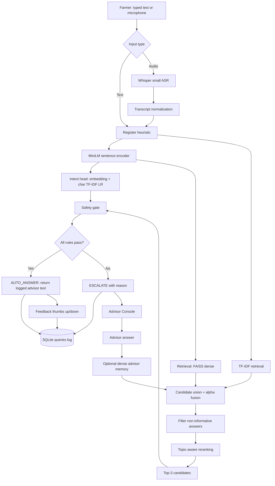
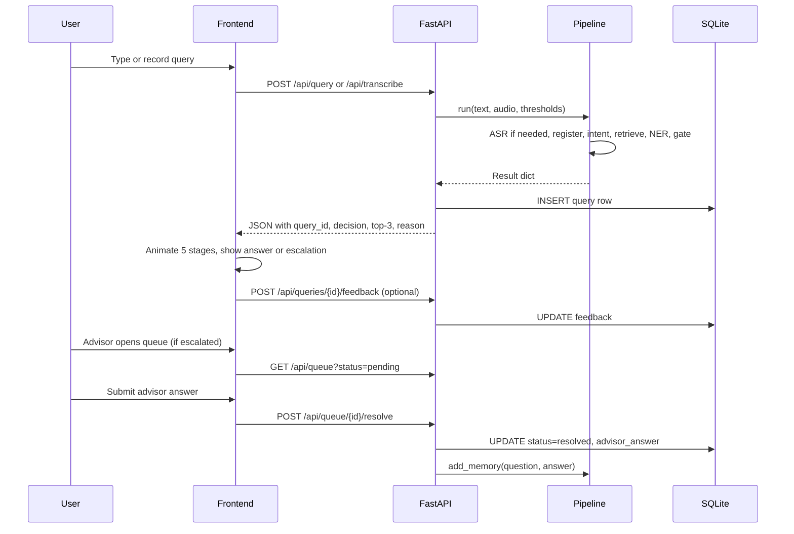
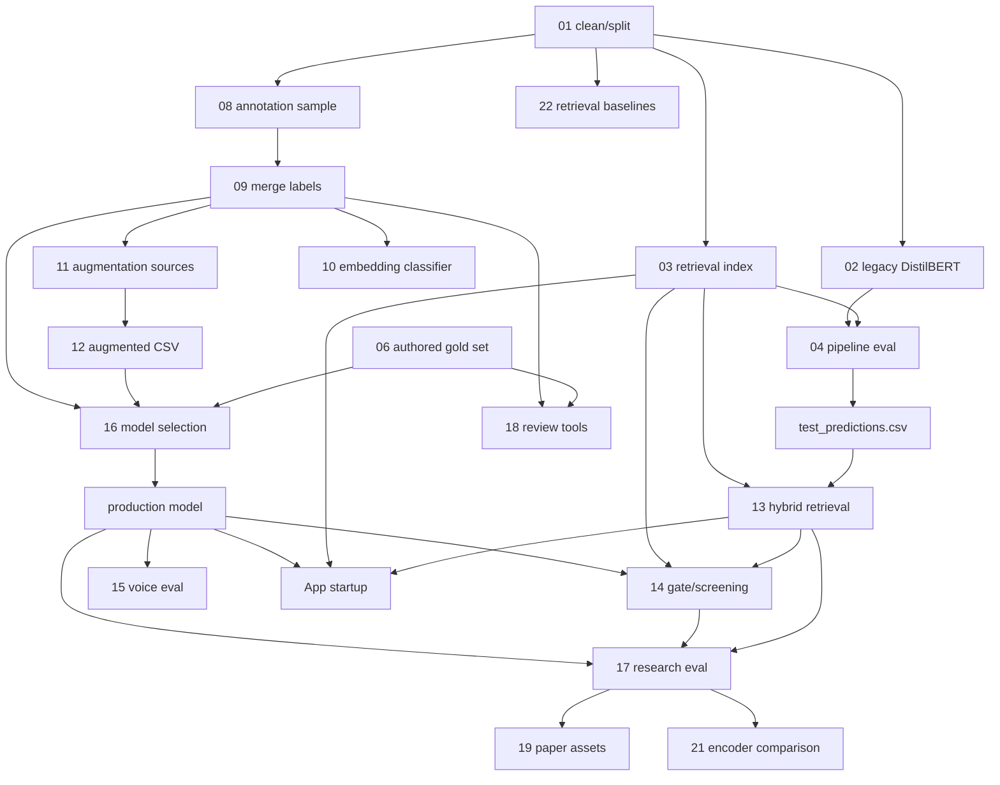
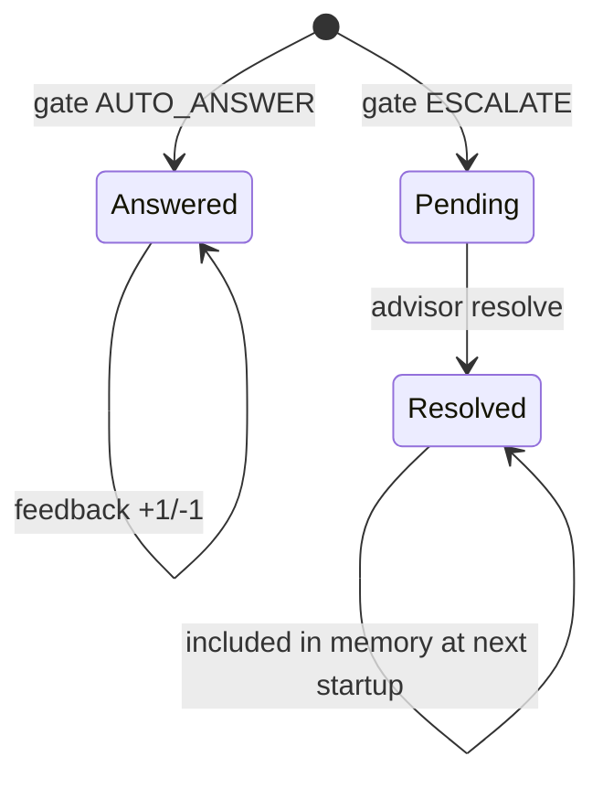

# KCC-Sahayak: Complete Reverse-Engineering and Operating Guide

**Snapshot:** repository at `/Users/chiranthml/Downloads/KCC-Sahayak-main`, commit `cf6aab3` (“Initial commit from ZIP source”). The tree was clean before this document was added; `this_is_it.md` is the only new file.

**Purpose of this document:** explain what the project is, how every part works, what data and models it uses, what the results actually mean, how to run and rebuild it, what is missing, and what you can safely claim in a demo, viva, report, or interview. It is written from the code, data, and result artifacts in this repository, not from the project pitch alone.

**Evidence labels used below**

| Label | Meaning |
|---|---|
| **Verified** | Directly checked in committed code, data, or result files. |
| **Reported** | Stated in README/docs/paper but not independently re-run here. |
| **Partial** | Artifact exists but is incomplete or internally inconsistent. |
| **Missing** | Referenced or required but absent from the repository. |
| **Stale** | Artifact exists but does not match the latest checked-in results. |
| **Unverified** | Plausible but not demonstrated by any committed evidence. |

> **Read this first — the five facts that change the story**
>
> 1. **The app does not run from a fresh clone.** `models/` is absent and gitignored. The retrieval index, intent head, and legacy classifier are all missing. `run_app.bat` does not build them.
> 2. **The labels are LLM-assisted, not human-verified.** The 250-row human review sheet is completely empty; there is no human agreement result.
> 3. **The retired 99% number was keyword-label agreement, not understanding.** Scored against meaning-based labels, the old DistilBERT is 65.7%.
> 4. **The corpus is not Haryana-specific and is not multilingual source text.** It is an Assam-heavy, English/Romanized advisor-log corpus with a few native-script answer rows. Hindi/Hinglish evaluation comes from LLM-authored gold/augmentation data.
> 5. **The paper assets are stale.** `paper/generated/numbers.tex` has old gate values and `n/a` for voice even though `results/voice_eval.json` exists. Regenerate assets before quoting the paper.

---

## Part 1 — Project at a Glance

### 1.1 What KCC-Sahayak is

KCC-Sahayak is a **research prototype and demonstration system** for triaging farmer questions from India’s Kisan Call Centre (KCC). It takes a typed or spoken question, predicts its agricultural intent, retrieves the closest previously logged question/answer pair, tags crops and pest terms, and then makes one of two decisions:

- **AUTO_ANSWER** — return the retrieved human-advisor answer, but only if the query passes every safety rule.
- **ESCALATE** — send the query to a human advisor queue with a stated reason.

It also includes a small web application (farmer demo, advisor console, operations dashboard, evaluation dashboard), an audit of the underlying KCC corpus, and a set of offline experiments.

### 1.2 What it is not

- It is **not a generative agronomist**. There is no LLM generating advice at inference time. Auto-answers are copied from logged human-advisor text.
- It is **not a replacement for KCC advisors**. It is a triage layer; roughly three quarters of queries are escalated by the full gate.
- It is **not Haryana-specific**. Despite the earlier framing, the available corpus is overwhelmingly Assamese in content and has no state column.
- It is **not production-ready**. There is no authentication, rate limiting, encryption, retention policy, monitoring, or deployment hardening.
- It is **not validated by agronomists**. Nobody has judged whether the auto-answers are agronomically correct.
- It is **not a completed human study**. The human review tooling exists, but the sheet is empty.

### 1.3 Snapshot of the important numbers

| Item | Value | Status |
|---|---:|---|
| Raw Q/A rows | 139,542 | Verified |
| Cleaned rows | 138,875 | Verified |
| Rows in the retrieval index (train + val) | 124,987 | Verified |
| Queries in the held-out weak-label test set | 13,888 | Verified |
| Meaning-labelled queries | 3,496 (3,000 train pool + 496 test pool) | Verified |
| Independent gold queries | 150 (50 per style, 15 per class) | Verified |
| Spoken-style paraphrases | 1,200 (400 sources × 3 styles) | Verified |
| Intent classes | 10 | Verified |
| Production intent accuracy, silver n=496 | 93.55% (95% CI 91.53–95.56) | Verified |
| Production intent accuracy, gold n=150 | 90.0% (95% CI 85.33–94.67) | Verified |
| Full-gate silver coverage / selective accuracy / policy violations | 26.41% / 95.42% / 2.29% | Verified |
| Full-gate gold coverage / selective accuracy / policy violations | 23.33% / 94.29% / 2.86% | Verified |
| Synthetic English voice WER, n=50 | 1.46% mean, median 0 | Verified |
| Human review rows completed | 0 of 250 | Verified |
| Committed model artifacts | None | Verified |
| Non-API unit tests passing manually | 31 (22 gate + 9 text-utils) | Verified |
| API tests run | 0 of 10 | Missing environment |

### 1.4 Repository map

| Path | What it contains | Why it matters |
|---|---|---|
| `README.md` | Project pitch, run command, current headline results, limitations | Best short orientation; some claims are stale (e.g. gate thresholds-only 92.3/72.3 vs current 92.54/71.68). |
| `FINAL_REPORT.md` | Concise research summary and next steps | Good high-level framing; says 8.7% call-log notes and 17/138,875 Haryana mentions. |
| `paper/` | LaTeX source, generated tables/figures, compiled `main.pdf` | Research write-up. **Generated assets are stale**; regenerate before quoting. |
| `docs/` | Viva guide, annotation guidelines, synopsis update, gap analysis | Useful intent and caveats; a few stale paths/claims. |
| `backend/app.py` | FastAPI app, request models, pipeline lifecycle, endpoints, static mount | The actual web API. |
| `backend/db.py` | SQLite schema, logging, queue, feedback, operations summary | The actual persistence and human loop. |
| `frontend/` | `index.html`, `assets/js/app.js`, `assets/css/styles.css` | Single-page demo and dashboards. |
| `src/` | Pipeline, retrieval, intent model, gate, NER, ASR, language ID, advisor memory | The reusable core. |
| `scripts/` | Numbered data/training/evaluation/reproduction scripts (00–22; 00 is PowerShell) | How artifacts were produced. |
| `data/raw/` | `kcc_mapping_full.csv` | Raw corpus, 139,542 rows, no metadata. |
| `data/processed/` | `train.csv`, `val.csv`, `test.csv`, `full_labeled.csv` | Cleaned splits with weak labels and NER columns. |
| `data/annotation/` | `annotated.csv`, `augmented.csv`, `pool.csv`, chunks, labels, augmentation sources | Meaning-based labels and paraphrases. |
| `data/gold/` | `gold_queries.csv` | Independent 150-query test set. |
| `data/review/` | `review_sheet.csv` | Empty human review sheet. |
| `results/` | Trusted, legacy, partial, and missing evaluation artifacts | Source of truth for numbers, but only some files are current. |
| `tests/` | `test_api.py`, `test_gate.py`, `test_text_utils.py` | 41 test functions total; API tests not run here. |
| `models/` | **Absent** (gitignored) | Required to run the app; must be rebuilt. |
| `demo/` | Voice-eval WAVs and sample assets | Allows voice eval without Windows SAPI. |
| `run_app.bat` | Windows launcher | Windows-only; assumes `.venv\Scripts\python.exe` and existing models. |

### 1.5 The three-minute reading path

1. Read this Part and Part 2.
2. Read the architecture diagram and request lifecycle in Part 3.
3. Read the denominator correction in Part 4 and the leakage table in Part 5.
4. Read the model inventory in Part 6 and the gate rules in Part 8.
5. Read the trust hierarchy in Part 11 before quoting any number.
6. Read Part 12 before trying to run anything.
7. Read the Q&A before a presentation.

---

## Part 2 — Problem, Goals, Contributions, and Scope

### 2.1 Background: what a Kisan Call Centre does

Farmers call a government helpline and speak to a Farm Tele Advisor. The advisor answers questions about crops, pests, fertiliser doses, weather, government schemes, market prices, varieties, animal husbandry, fisheries, and general cultivation practices. The KCC logs contain the farmer’s question and the advisor’s answer as text.

Useful automation is hard for several reasons:

- Questions are short, noisy, code-mixed, and often speech-derived.
- Advice can be dangerous if wrong, especially pesticide doses and fertiliser quantities.
- Weather and market prices go stale immediately.
- Many logged “answers” are call-log notes (“explained in details”, “transferred to expert”) rather than advice.
- The corpus has duplicate and near-duplicate questions, so random test splits overstate retrieval performance.
- The available corpus is not representative of every state or language.

### 2.2 Problem statement

> Given a farmer’s typed or spoken question, decide whether the system can safely return a previously logged human-advisor answer, or whether the question must be escalated to a human. Do this in a way that is measurable, auditable, and honest about its uncertainty.

The project is therefore a **selective prediction / triage** problem, not a “answer every question” problem.

### 2.3 Goals

| Goal | How the project approaches it |
|---|---|
| Understand the query | 10-class intent classifier over a multilingual sentence encoder plus character n-grams. |
| Find a useful past answer | Dense FAISS retrieval fused with TF-IDF; filter non-informative answers. |
| Handle spoken input | Whisper `small`, a domain vocabulary prompt, and transcript normalization. |
| Avoid unsafe automation | Content-aware safety gate: high-stakes and time-sensitive categories, confidence thresholds, topic match, answer-quality screen, dosage/chemical screen. |
| Keep humans in the loop | Escalated queries go to SQLite queue; advisor answers can be added to retrieval memory. |
| Measure honestly | Held-out silver set, independent gold set, CIs, McNemar tests, ablations, leakage audit. |
| Expose the audit | Evaluation dashboard and paper report label validity, near-duplicates, call-log notes, geography. |

### 2.4 Contributions the project can defend

1. **A corpus audit** showing keyword-label validity, test-set near-duplicate leakage, call-log-note prevalence, and Assam-heavy geography.
2. **Meaning-based annotation** of 3,496 corpus queries with written guidelines, plus an independent 150-query gold set in English, Hinglish, and Hindi.
3. **A hybrid retrieval and intent system** over one multilingual encoder, with strong silver-set performance and a smaller but real gain from hybrid retrieval.
4. **A content-aware safety gate** that goes beyond confidence thresholds: it refuses high-stakes/time-sensitive categories and screens the retrieved answer itself.
5. **A quantitative gate ablation** showing what each rule buys in coverage, selective accuracy, and rule-defined policy violations.
6. **A human-in-the-loop feedback path** from escalation to advisor answer to retrieval memory.
7. **An honest reproducibility package**: scripts, result JSONs, tests, and documented limitations.

### 2.5 Non-goals

- Diagnosing plant disease from images.
- Generating novel agronomic advice.
- Giving real-time weather or mandi prices.
- Replacing the KCC or its advisors.
- Proving generalization to every Indian state or language.
- A production security/deployment story.
- A completed human or agronomist evaluation.

### 2.6 The ten intent classes

| Code | Label | Meaning | High-stakes? | Time-sensitive? |
|---|---|---|---|---|
| PP | Plant Protection | Pest/disease control, pesticide/spray advice | Yes | No |
| NM | Nutrient Management | Fertiliser choice, dose, application | Yes | No |
| Weather | Weather | Forecast, rainfall, temperature | No | Yes |
| GS | Government Scheme | Subsidy, loan, insurance, scheme eligibility | Yes | No |
| MP | Market Price | Mandi rate, current price | No | Yes |
| VI | Varietal Information | Which variety/hybrid, seed source, suitability | No | No |
| AH | Animal Husbandry | Cattle, buffalo, goats, feed, milk, health | No | No |
| FI | Fisheries | Fish farming, ponds, fish health | No | No |
| CP | Cultural Practices | Sowing, irrigation, spacing, general agronomy | No | No |
| Other | Other | Unclear, off-topic, or none of the above | No | No |

The high-stakes and time-sensitive sets are defined in `src/glossary.py` and used by `src/confidence_gate.py`.

### 2.7 What “success” means here

The project deliberately reports several numbers, not one:

- **Silver accuracy** — intent accuracy on 496 held-out corpus queries labelled by meaning.
- **Gold accuracy** — intent accuracy on 150 independently written queries.
- **Coverage** — fraction of queries the gate auto-answers.
- **Selective accuracy** — intent accuracy among auto-answered queries.
- **Policy violations** — fraction of auto-answers whose true label is high-stakes/time-sensitive, or whose returned text contains dosage/chemical advice or is non-informative.
- **Answer F1** — lexical overlap between the retrieved answer and the advisor’s real answer.
- **WER** — word error rate of speech recognition.

None of these is “the accuracy of the whole system”. Intent accuracy is not answer correctness; policy violations are not proven harm; answer F1 is not agronomic quality.

---

## Part 3 — End-to-End Architecture

### 3.1 System diagram



### 3.2 Stage-by-stage table

| Stage | Code | Input | Output | Model/artifact | Runs where |
|---|---|---|---|---|---|
| Input validation | `backend/app.py` request models | JSON or audio upload | Clean text or temp audio | None | API |
| Speech recognition | `src/asr.py` | Audio file | Transcript, detected language | Whisper `small` | Local CPU/GPU |
| Transcript normalization | `src/asr.py::normalize_transcript` | Raw Whisper text | Cleaned text | Regex rules | Local |
| Register detection | `src/lang.py::detect_register` | Text | `en`, `hinglish`, or `hi` | Heuristic word/script rules | Local |
| Embedding | `src/pipeline.py` | Text | Sentence vector | `paraphrase-multilingual-MiniLM-L12-v2` | Local/CPU |
| Intent classification | `src/intent_model.py` | Embedding + text | 10 probabilities, top-3 | Logistic regression + TF-IDF | Local |
| Dense retrieval | `src/retrieval.py` | Embedding | Top candidates, cosine scores | FAISS `IndexFlatIP` | Local |
| Sparse retrieval | `src/retrieval.py` | Text | Top candidates, TF-IDF scores | Word 1–2 gram TF-IDF | Local |
| Fusion | `src/retrieval.py::search` | Candidate union | Fused ranking | `alpha=0.4` | Local |
| Answer filtering | `src/answer_quality.py` | Answer text | Informative mask | Typo-tolerant call-log rules | Local |
| Topic reranking | `src/retrieval.py::search` | Query type + candidate types | Reordered candidates | Predicted labels | Local |
| Entity tagging | `src/ner.py` | Text | Crop/symptom lists | Gazetteer | Local |
| Safety gate | `src/confidence_gate.py` | Query type, confidence, similarity, candidate, answer | Decision and reason | Rule engine | Local |
| Persistence | `backend/db.py` | Serialized result | SQLite row | None | Local |
| UI | `frontend/` | API responses | Interactive pages | Chart.js CDN, fonts CDN | Browser |

### 3.3 Why one encoder feeds two heads

The project uses one multilingual sentence encoder for two purposes:

- **Intent:** the embedding is concatenated with character n-gram TF-IDF features and passed to a logistic regression. The embedding gives cross-lingual meaning; the character features give in-language spelling evidence.
- **Retrieval:** the same embedding is normalized and searched with FAISS. This avoids loading a second semantic model and keeps the runtime small.

This is a deliberate engineering trade-off. It is **not** the only possible design, and the project does not claim it is optimal. A character n-gram SVM is statistically indistinguishable on intent; the embedding’s measurable value is zero-shot Hindi transfer (68% vs 4% without Hindi training data, per the committed ablation in `research_eval.json`).

### 3.4 Request lifecycle



### 3.5 Online vs offline

| Phase | What happens | Artifacts |
|---|---|---|
| **Offline data preparation** | Clean raw corpus, weak labels, split, annotate, augment, build gold/review sets | `data/processed/`, `data/annotation/`, `data/gold/`, `data/review/` |
| **Offline model build** | Train intent, build FAISS/TF-IDF, select model, calibrate, evaluate | `models/`, `results/` |
| **Runtime startup** | Load encoder, intent head, retrieval index, optional TF-IDF, rebuild advisor memory from SQLite | In-memory pipeline |
| **Runtime request** | Embed, classify, retrieve, tag, gate, log, return | SQLite row |
| **Human loop** | Advisor resolves queued query; optional memory add | SQLite row + in-memory memory |

### 3.6 Deployment topology

- One Python process serves both the API and the static frontend.
- The frontend is plain HTML/CSS/JS; no build step.
- SQLite stores all query logs and queue state in `data/app.db`.
- No external vector database; FAISS and TF-IDF are in-process.
- No message queue, cache, container, or cloud dependency.
- The only network calls are model downloads from Hugging Face/OpenAI Whisper on first use, and frontend CDN/font requests.
- The app is designed for a local demo, not multi-tenant deployment.

### 3.7 Trust boundaries

| Boundary | What crosses it | Risk |
|---|---|---|
| Browser → API | Free text, audio, advisor answers | No auth; any client can submit/resolve. |
| API → local models | User text/audio | Model downloads and local inference only. |
| API → SQLite | Full query text, suggested answer, advisor answer | Unencrypted local storage; possible PII. |
| API → advisor memory | Advisor answer | In-memory only; rebuilt on restart; no dedup. |
| Corpus → retrieval | Logged answers | Contains call-log notes and possible PII. |
| Model → farmer | Retrieved human text | Can be stale, terse, or contextually wrong. |

---

## Part 4 — Dataset and Provenance

### 4.1 Raw data file

| Property | Value |
|---|---|
| Path | `data/raw/kcc_mapping_full.csv` |
| Size | ~17 MB |
| Encoding | UTF-8 |
| Columns | `questions`, `answers` |
| Rows | 139,542 |
| Unique questions | 87,293 |
| Unique answers | 97,583 |
| Unique question–answer pairs | 139,542 |
| Empty questions | 1 |
| Median question length | 42 characters |
| Maximum question length | 1,005 characters |
| Median answer length | 57 characters |
| Maximum answer length | 7,755 characters |
| State/language/date/crop metadata | None |

### 4.2 Provenance: what is known and what is not

**Known from the repository**

- The file is a two-column CSV of KCC question/answer logs.
- The README, paper, and synopsis call it a “public multi-state KCC corpus” or “public mirror”.
- The corpus content is overwhelmingly Assamese in character.
- `results/corpus_geography.json` counts 17 Haryana mentions vs 5,840 Assam mentions across 138,875 cleaned queries.
- There is no audio, no state column, no language column, and no query-type label.
- `docs/SYNOPSIS_UPDATE.md` says the official Haryana export is CAPTCHA-protected and the public corpus has almost no Haryana rows.

**Not known from the repository**

- The exact source URL or dataset DOI.
- The download date or KCC reporting period.
- The license or terms of use.
- Who transcribed the calls.
- How states, languages, or crops were sampled.
- Whether the “public mirror” is the original source or a derivative.
- Whether personal data was removed before or after the mirror was created.

**Do not invent a source URL.** If you need one for a report, say “the repository does not record the source URL; the README describes the data as a public multi-state KCC mirror.”

### 4.3 Script and language distribution

| Script | Question rows | Answer rows |
|---|---:|---:|
| Latin/Roman | 139,542 (all) | Almost all |
| Devanagari | 0 | 144 |
| Bengali | 0 | 111 |
| Gujarati | 0 | 12 |
| Telugu | 0 | 3 |
| Tamil | 0 | 1 |

Notes:

- The answer counts are rows containing at least one character in that script; a row can contain multiple scripts.
- The corpus is not a parallel multilingual corpus. It is primarily English/Romanized advisor-log text with a small number of native-script answer rows.
- Hinglish is not a corpus label; it is inferred by the register heuristic for display and analytics.
- Hindi, Hinglish, and Devanagari training/evaluation exist only in the annotation, augmentation, and gold sets.

### 4.4 Geography audit

| Measure | Value | Denominator | Source |
|---|---:|---:|---|
| Haryana place mentions | 17 | 138,875 cleaned queries | `results/corpus_geography.json` |
| Assam place/crop-term mentions | 5,840 | 138,875 cleaned queries | `results/corpus_geography.json` |

**Caveat:** these are broad regex counts, not verified state labels.

- The Assam pattern includes district names, Assamese rice terms, and the land-unit word `katha`; it can match non-Assam text.
- The Haryana pattern includes city names; it can miss rural references and can match common words.
- The paper uses `\corpusRows` (which is 124,987, the retrieval index) as the denominator in one sentence, but the geography JSON uses 138,875. The correct statement is **17 of 138,875**, not 17 of 124,987.

### 4.5 PII-like content

No PII scrubbing is performed. The following are **regex/keyword counts, not manually verified PII**:

| Pattern/keyword | Questions | Answers | Notes |
|---|---:|---:|---|
| Phone-like numbers | 6 | 1,379 | `(?<!\d)(?:\+?91[-\s]?)?[6-9]\d{9}(?!\d)`; likely false positives/negatives. |
| Email addresses | 0 | 663 | Standard email regex. |
| URLs | 0 | 72 | `https?://` or `www.`. |
| 12-digit-like numbers | 0 | 6 | `(?<!\d)\d{12}(?!\d)`; may overlap Aadhaar-like IDs. |
| “Aadhaar/aadhar/adhar” | 32 | 1,016 | Broad keyword mention, not necessarily a real number. |
| “Account no/number” | 5 | 53 | Phrase match. |
| IFSC | 6 | 149 | Keyword match. |
| “Farmer name” | 0 | 67 | Phrase match. |
| “VLE” | 25 | 392 | Broad acronym match; may include unrelated uses. |
| “Mobile” | 10 | 143 | Keyword match. |
| “Contact” | 307 | 6,107 | Very broad; includes “contact officer”, etc. |
| “Address” | 265 | 241 | Keyword match. |
| “Bank” | 80 | 2,232 | Very broad; includes bank account and river bank. |

These are **regex/keyword counts, not verified PII**. Broad terms such as “bank” and “contact” overcount; phone/email/URL regexes can miss formatted values. The point is that the raw corpus contains many matches consistent with names, phone numbers, addresses, and bank/branch details, so it should not be described as PII-free without redaction evidence.

What this means:

- The raw corpus contains many regex/keyword matches consistent with names, phone numbers, addresses, and bank/branch details; these are not manually verified.
- The paper’s ethics line says “No personal data about farmers is used; the corpus is public.” That claim is **not supported by the shipped raw file** as written. Before submission, either redact the corpus or qualify the claim.
- The app stores raw query text and answers in SQLite without encryption or retention controls.
- Do not paste real rows into slides, reports, or chat without redaction.

### 4.6 Sample schema (not sample content)

```text
questions: string   # farmer's logged question, often terse and Romanized
answers:   string   # advisor's logged answer or call-log note
```

After processing, additional columns appear:

| Column | Meaning |
|---|---|
| `qid` | Sequential integer row ID assigned after cleaning (`df.reset_index(drop=True); df["qid"] = df.index`). It is not a hash and is stable only for a given run/row order. |
| `query_type` | Weak keyword label (10 classes). |
| `crop` | Semicolon-joined crop entities from the gazetteer. |
| `symptom` | Semicolon-joined pest/symptom entities. |
| `label` | Meaning-based label in annotation/gold files. |
| `style` | `en`, `hinglish`, or `hi` in gold/augmentation. |
| `pool` | `train` or `test` in `annotated.csv`. |
| `source_id` | Original query ID for augmentation. |

### 4.7 What the dataset can and cannot support

**Can support**

- Audit of label validity against an LLM-assisted meaning label set.
- Study of near-duplicate leakage and retrieval inflation.
- Study of call-log-note prevalence.
- A demonstration of triage, escalation, and human feedback.
- A small multilingual robustness check using synthetic/gold queries.

**Cannot support**

- State-specific claims (especially Haryana).
- Real spoken-language claims (no audio; synthetic speech only).
- Real-time weather or price claims (logged answers are stale).
- Agronomic correctness claims (no expert labels).
- Population-level prevalence claims (unknown sampling).
- Causal claims about advisor behavior or farmer outcomes.
- Claims about all Indian languages (only small en/hinglish/hi sets).

### 4.8 Important denominator correction

The repository uses two different corpus sizes, and some prose conflates them:

| Quantity | Value | Meaning |
|---|---:|---|
| Raw rows | 139,542 | Before cleaning. |
| Cleaned rows | 138,875 | All splits after short-text removal. |
| Retrieval index rows | 124,987 | Train + validation only; test excluded. |
| Call-log-note audit | 8.77% of 138,875; 8.75% of 124,987 | Both are approximately 8.7–8.8%. |
| Geography audit | 17 / 138,875 Haryana; 5,840 / 138,875 Assam | Uses full cleaned corpus. |

`paper/main.tex` says “a public mirror … (`\corpusRows` unique pairs after cleaning)”, where `\corpusRows` is 124,987. That is **not** the number of cleaned pairs; 138,875 is. The paper’s corpus-size sentence and its geography denominator should be corrected before submission.

---

## Part 5 — Cleaning, Labelling, Splits, and Leakage

### 5.1 Cleaning pipeline

Implemented in `scripts/01_prepare_data.py`.

| Step | Operation | Effect |
|---|---|---|
| 1 | Read raw CSV | 139,542 rows. |
| 2 | Lowercase and collapse whitespace | Normalizes surface form. |
| 3 | Drop rows where question or answer is shorter than 8 characters | Removes 667 rows total, including 1 empty question and short answers. |
| 4 | Drop exact `(question, answer)` duplicates | No-op: all raw pairs are unique. |
| 5 | Drop remaining NA | No additional rows in the committed data. |
| 6 | Add `qid` | Sequential row index after cleaning; not a hash. |
| 7 | Weak keyword labels | Adds `query_type`. |
| 8 | Gazetteer entities | Adds `crop` and `symptom`. |
| 9 | Stratified split | 80/10/10 by weak label, `random_state=42`. |
| 10 | Write splits | `train.csv`, `val.csv`, `test.csv`, `full_labeled.csv`. |

### 5.2 Row accounting

```text
Raw rows                         139,542
- short/empty question or answer     667
- exact pair duplicates                0
= cleaned rows                   138,875
```

Processed corpus:

| Property | Value |
|---|---:|
| Rows | 138,875 |
| Unique questions | 87,046 |
| Unique answers | 97,262 |
| Empty questions | 0 |
| Exact duplicate pairs | 0 |
| Duplicate-question groups | 14,906 |
| Extra duplicate-question rows | 51,829 |

For reference, the raw file has 14,969 groups and 52,249 extra duplicate-question rows; cleaning removes some of them. The duplicate-question count is the important one: many different answers share the same normalized question. The split is by row, not by question, so the same question can appear in train and test.

### 5.3 Weak keyword labels

The weak labels are rule-based and were used only to stratify splits and sampling. They are **not** the meaning labels.

| Code | Label | Full corpus | Train | Test |
|---|---|---:|---:|---:|
| PP | Plant Protection | 53,813 | 43,050 | 5,382 |
| Other | Other | 41,471 | 33,177 | 4,147 |
| NM | Nutrient Management | 19,871 | 15,897 | 1,987 |
| GS | Government Scheme | 6,404 | 5,123 | 641 |
| VI | Varietal Information | 6,428 | 5,142 | 643 |
| AH | Animal Husbandry | 4,776 | 3,821 | 478 |
| FI | Fisheries | 3,139 | 2,511 | 314 |
| CP | Cultural Practices | 1,847 | 1,478 | 184 |
| MP | Market Price | 679 | 543 | 68 |
| Weather | Weather | 447 | 358 | 44 |

The weak-label distribution is severely imbalanced; Plant Protection is about 38.8% of the full corpus. The weak labels agree with meaning labels only **67.51%** of the time (`results/annotation_summary.json`).

### 5.4 Meaning-based annotation

| Property | Value |
|---|---|
| File | `data/annotation/annotated.csv` |
| Rows | 3,496 |
| Train pool | 3,000 |
| Test pool | 496 |
| Classes | 10 |
| Label source | One LLM assistant, per `docs/annotation_guidelines.md` |
| Human verification | None completed |
| Sampling | Stratified by weak label with lexical-diversity filter (6-word prefix) |
| Split assignment | Train pool maps to train queries; test pool maps to test queries; no validation pool |
| Docstring discrepancy | `08_sample_for_annotation.py` says 500 test rows; actual quota is 496 |

Label distribution:

| Label | Train pool | Test pool | Total |
|---|---:|---:|---:|
| PP | 677 | 113 | 790 |
| CP | 454 | 86 | 540 |
| NM | 397 | 61 | 458 |
| AH | 373 | 68 | 441 |
| GS | 288 | 48 | 336 |
| FI | 236 | 38 | 274 |
| VI | 232 | 32 | 264 |
| Other | 160 | 19 | 179 |
| Weather | 129 | 22 | 151 |
| MP | 54 | 9 | 63 |

Notes:

- The annotation is not proportional to the weak-label distribution; it is stratified with quotas.
- The test pool is 496, not 500. This is a documentation slip, not a data bug.
- The labels should be described as “LLM-assisted, not human-verified”, not “human-labelled”.
- `docs/annotation_guidelines.md` names Claude as the assistant; the README says “one LLM assistant”. The repository does not record a model version or prompt logs.
- Agreement between weak and meaning labels is 67.51%; this is the source of the retired 99% illusion.

### 5.5 Spoken-style augmentation

| Property | Value |
|---|---|
| File | `data/annotation/augmented.csv` |
| Rows | 1,200 |
| Unique source IDs | 400 |
| Styles | `en`, `hinglish`, `hi` — 400 each |
| Labels | 10 classes — 120 each |
| Sources per class | 40 |
| Source restriction | 400 source IDs from the 3,000 train pool; test/silver excluded |
| One duplicate text | Yes: the same text appears twice under two source IDs, both Weather/hi |
| Author | Same LLM assistant as labels/gold |
| Purpose | Teach spoken style and cross-lingual phrasing |

Important: the augmentation is **paraphrase text**, not new human questions. It is the decisive ingredient for gold performance: without it, gold accuracy falls from 90% to 60%.

### 5.6 Independent gold set

| Property | Value |
|---|---|
| File | `data/gold/gold_queries.csv` |
| Rows | 150 |
| Styles | 50 English, 50 Hinglish, 50 Devanagari Hindi |
| Labels | 15 per class |
| Overlap with corpus | No exact question overlap |
| Overlap with annotated/augmented | Zero exact overlap |
| Author | Same LLM assistant for queries and labels |
| Human verification | None |
| Role | Independent test set; used in model selection (a methodological caveat) |

The gold set is independent of the **training data**, but not of the **annotator**. It is also used by `16_model_selection.py` to choose the production model, so its final metrics are selection-contaminated.

### 5.7 Human review sheet

| Property | Value |
|---|---|
| File | `data/review/review_sheet.csv` |
| Rows | 250 |
| `human_label` | Completely empty |
| Header | UTF-8 BOM (`\ufeffid`) |
| Answer key | `data/review/answer_key_DO_NOT_SHARE.csv` absent/gitignored |
| Agreement result | `results/human_agreement.json` absent |
| Tool | `scripts/18_review_tools.py make/score` |

The paper says “only partly human-verified”; the committed evidence shows **zero** completed human verification. The honest wording is: “human verification is planned; the review sheet is empty and no kappa has been computed.”

### 5.8 Splits and leakage

| Split | Rows | Unique questions |
|---|---:|---:|
| Train | 111,100 | 72,185 |
| Validation | 13,887 | 11,801 |
| Test | 13,888 | 11,940 |
| Total | 138,875 | 87,046 (unique across the corpus; split uniques overlap and do not sum) |

Exact-question overlap:

| Overlap | Count | Interpretation |
|---|---:|---|
| Test **rows** whose question appears in train | 6,247 | 44.98% of the 13,888 test rows. |
| Test **rows** whose question appears in validation | 3,053 | Additional leakage across validation. |
| Test **rows** whose question appears in train **or** validation | 6,436 | 46.34% of test rows. |
| Distinct test questions in train / validation / either | 4,379 / 1,637 / 4,555 | 38.15% of the 11,940 distinct test questions appear in train or validation. |
| Validation **rows** whose question appears in train | 6,332 | 45.60% of validation rows. |
| Distinct validation questions in train | 4,325 | Validation is also contaminated. |

The distinction matters: 6,247/3,053/6,436 are **row** counts; 4,379/1,637/4,555 are **distinct-question** counts. Always state which one you mean.

Near-duplicate audit on the 3,000 weak-label test subset:

| Similarity threshold | Share of test queries |
|---|---:|
| ≥ 0.95 | 70.73% |
| ≥ 0.90 | 83.53% |
| < 0.80 (“novel”) | 4.93% |

Retrieval category match:

| Subset | Category match |
|---|---:|
| Near-duplicate queries | 98.07% |
| Novel queries | 73.65% |

This is the central audit finding: retrieval and intent scores on a random row split look much better than they would on genuinely unseen questions.

### 5.9 How much data each model sees

| Model/artifact | Training data | Evaluation data |
|---|---|---|
| Production intent LR | 3,000 annotated train + 1,200 paraphrases = 4,200 rows | 496 silver + 150 gold; 3,000 weak-label test for legacy comparison |
| Legacy DistilBERT | 20,000 proportional weak-label train rows | Weak-label test; meaning-labelled test for critique |
| Dense retrieval index | 124,987 train+val Q/A pairs | 2,737 answer-F1 rows; silver/gold queries for gate evaluations |
| TF-IDF retrieval | Same 124,987 questions | Same 2,737 answer-F1 rows |
| Calibration | Out-of-fold logits from the 4,200 training rows | Silver/gold checks |
| Advisor memory | Runtime resolved answers | Runtime retrieval |

### 5.10 Data caveats to state aloud

- The split is by row, not by question; 46.34% of test rows (38.15% of distinct test questions) also appear in train or validation.
- Near-duplicate leakage is worse than exact leakage: 70.73% at cosine ≥0.95.
- The cleaned corpus has 14,906 duplicate-question groups (14,969 in the raw file); different answers often share a question.
- The annotation is small (3,496) and not human-verified.
- The gold set is 150 rows; per-language n=50 gives wide 95% intervals (roughly ±8–14 points, depending on the observed accuracy).
- The augmentation and gold share an author, so Hindi/Hinglish results are likely optimistic.
- The retrieval index excludes test, which is correct, but the retrieval evaluation uses a test subset drawn from the same weak-label distribution.
- The call-log filter is typo-tolerant but rule-based; it can miss unusual notes.
- The corpus has PII-like content and no redaction.

---

## Part 6 — Models and Algorithms

### 6.1 Model inventory

| Component | Type | Role | Pretrained here? | Trained/fit here? | Artifact | Status |
|---|---|---|---|---|---|---|
| Sentence encoder | `paraphrase-multilingual-MiniLM-L12-v2` | Shared embedding for intent and retrieval | Yes, downloaded | Not fine-tuned | Hugging Face cache | Missing locally until downloaded |
| Production intent head | Logistic regression + char TF-IDF | 10-class intent | No | Yes | `models/intent_embed_lr/model.joblib` | Missing |
| Legacy intent classifier | DistilBERT multilingual + linear head | Fallback/legacy intent | Yes, base | Fine-tuned by `02` | `models/intent_classifier/` | Missing |
| Dense retrieval | FAISS `IndexFlatIP` | Nearest-neighbour search | No | Built from corpus | `models/retrieval_index/kcc_index.faiss` | Missing |
| Retrieval TF-IDF | Word 1–2 gram TF-IDF | Sparse retrieval and fusion | No | Fit on corpus | `models/retrieval_index/tfidf.joblib`, `tfidf_matrix.npz` | Missing |
| Retrieval metadata | CSV | Question/answer/type mapping | No | Generated | `models/retrieval_index/corpus_metadata.csv` | Missing |
| Embeddings | NumPy array | Dense vectors | No | Generated | `models/retrieval_index/embeddings.npy` | Missing |
| NER | Gazetteer | Crop/pest tagging | No | No | `src/ner.py` + `src/glossary.py` | Code only |
| Language ID | Regex/word-list heuristic | Register display | No | No | `src/lang.py` | Code only |
| ASR | Whisper `small` | Speech-to-text | Yes, downloaded | Not fine-tuned | Whisper cache | Missing locally until downloaded |
| Safety gate | Rule engine | Auto-answer/escalate | No | No | `src/confidence_gate.py` | Code only |
| Advisor memory | Dense-only in-memory arrays (`KCCSahayakPipeline`) | Retrieve advisor answers | No | Runtime add | RAM + SQLite rebuild; code in `src/pipeline.py` | Code only |

### 6.2 Production intent model

**Architecture**

```text
text
  ├─ MiniLM sentence embedding (normalized)
  └─ character n-gram TF-IDF (char_wb, 2–5 grams)
        │
        └─ hstack → logistic regression → 10 probabilities → temperature scaling
```

**Exact settings in `src/intent_model.py`**

| Setting | Value |
|---|---|
| Encoder | `paraphrase-multilingual-MiniLM-L12-v2` |
| Embedding normalization | L2-normalized |
| Sparse features | `TfidfVectorizer(analyzer="char_wb", ngram_range=(2,5), min_df=2, sublinear_tf=True)` |
| Classifier | `LogisticRegression(C=10, max_iter=3000)` |
| Embedding weight | 1.0 |
| Temperature | 0.75 |
| Random seed | 42 where applicable |
| Training rows | 4,200 (3,000 annotation + 1,200 augmentation) |
| Classes | 10 |

**Why character n-grams:** they tolerate spelling variation and code-mixing (`gehu`, `gehun`, `gheu`) and give the model in-language evidence that a multilingual embedding may blur. They are also why a char SVM is a strong baseline.

**Why temperature scaling:** the raw logistic-regression probabilities are overconfident. Temperature 0.75 is fitted on out-of-fold logits and reduces expected calibration error from 3.78% to 0.51% on out-of-fold data. On silver it slightly worsens ECE (1.77% → 2.32%), so calibration is not uniformly better.

### 6.3 Legacy DistilBERT classifier

`scripts/02_train_intent_classifier.py` trains a fallback classifier on weak labels.

| Setting | Value |
|---|---|
| Base model | `distilbert-base-multilingual-cased` |
| Training data | Up to 20,000 weak-label train rows, sampled proportionally by class (not exactly class-balanced) |
| Epochs | 3 |
| Batch size | 32 |
| Max sequence length | 64 |
| Learning rate / weight decay / warmup | Not set explicitly; library defaults apply (not pinned) |
| Sampling seed | 42 |
| Artifact | `models/intent_classifier/` + `label_encoder.json` |
| Test accuracy on weak labels | 99.5% |
| Test accuracy on meaning labels | 65.7% |

The legacy model is important for the story, not for production. Its 99.5% is agreement with the keyword rules that generated its labels, not understanding. Because the script does not set LR/weight decay/warmup, the exact fine-tune depends on the installed Transformers version.

### 6.4 Dense retrieval

Implemented in `src/retrieval.py`.

| Property | Value |
|---|---|
| Index type | FAISS `IndexFlatIP` (exact inner product) |
| Vectors | L2-normalized MiniLM embeddings |
| Indexed rows | 124,987 (train + validation) |
| Metadata | `corpus_metadata.csv` |
| Similarity | Cosine similarity (inner product of normalized vectors) |
| Pool size at query time | 8 (pipeline); 200 before gate/topic reranking in some experiments |
| Test rows indexed? | No |

FAISS is a library, not a trained model. Building the index is deterministic given the embeddings.

### 6.5 Sparse retrieval and fusion

| Property | Value |
|---|---|
| Vectorizer | `TfidfVectorizer(ngram_range=(1,2), min_df=1, sublinear_tf=True, dtype=float32)` |
| Fit corpus | 124,987 train+val questions |
| Fusion | `alpha * dense + (1 - alpha) * tfidf` |
| Chosen alpha | 0.4 |
| Candidate strategy | Union of dense and sparse top candidates, then rank |
| Informative filter | Applied at query time, not at index build |
| Topic reranking | Candidates whose predicted type matches the query type are ranked first |
| Advisor memory | Separate dense-only array; not added to FAISS/TF-IDF |

The paper says “only informative answers are indexed.” Strictly, all rows are in the FAISS/TF-IDF structures; non-informative answers are filtered from candidate lists at search time. The behavioral effect is similar, but the implementation wording is imprecise.

### 6.6 Gazetteer NER

`src/ner.py` uses `src/glossary.py` and a compiled regex of crop and pest/symptom terms.

| Property | Value |
|---|---|
| Method | Longest-match gazetteer |
| Crops | 55 terms |
| Pest/symptom terms | 38 terms |
| Languages | English terms only |
| Trained? | No |
| Used by gate? | No; display/logging only |
| Output | `{"crop": [...], "symptom": [...]}` |

Because the term list is English, Devanagari and Hinglish questions often get empty entity lists. This does not affect the intent decision or gate; it only affects the UI and database fields.

### 6.7 Register detection

`src/lang.py::detect_register` returns `hi`, `hinglish`, or `en` using:

- Devanagari character ratio;
- Roman-Hindi word lists;
- fallback to English.

It is a display/analytics heuristic, not a trained language identifier. It is not required by the intent model.

### 6.8 Speech recognition

`src/asr.py` loads Whisper `small` lazily.

| Property | Value |
|---|---|
| Model | `openai-whisper` `small` |
| Language | Auto-detected |
| Domain prompt | Vocabulary hint with crops, pests, and KCC terms |
| Normalization | Lowercase, punctuation cleanup, whitespace, common ASR substitutions |
| Urdu handling | If detected as Urdu, re-decode with Hindi language hint |
| Fine-tuned? | No |
| Evaluation | 50 synthetic English TTS queries only |
| Hindi/Hinglish speech | Not tested |

### 6.9 Safety gate

Detailed in Part 8. Summary:

- High-stakes categories always escalate.
- Time-sensitive categories always escalate.
- Low intent confidence escalates.
- Low retrieval similarity escalates.
- Topic mismatch escalates.
- Non-informative answer escalates.
- Dosage/chemical answer escalates.
- Otherwise auto-answer.

### 6.10 What is trained here vs downloaded

| Downloaded pretrained | Trained/fitted in this repo |
|---|---|
| MiniLM sentence encoder | Production logistic-regression intent head |
| Whisper `small` | Character TF-IDF vectorizer (intent) |
| DistilBERT base (legacy) | DistilBERT fine-tune (legacy) |
| LaBSE/MuRIL/IndicBERTv2 (encoder comparison) | Word/char TF-IDF retrieval matrices |
| — | FAISS index (built, not trained) |
| — | Calibration temperature |
| — | No NER model; gazetteer only |

### 6.11 Why no generative LLM at inference

The project deliberately returns human-written advisor text rather than generating advice. Reasons:

- Generative models can invent pesticide doses or unsafe mixing instructions.
- The project wants provenance: the answer is a logged human answer.
- The gate can inspect the retrieved text for dosage/chemical language.
- The research question is triage, not generation.

The repository does **not** include an LLM+RAG baseline; that is listed as future work.

### 6.12 Model selection and its caveat

`scripts/16_model_selection.py` compares candidate heads and selects `combo_lr_C10_w1` using:

```text
selection_score = mean(silver_accuracy, gold_en, gold_hi, hinglish_perturbed)
```

It **excludes** `gold_hinglish` and `gold_all` from the selection score. The selected model reports:

| Metric | Value |
|---|---:|
| Silver | 93.55% |
| Gold all | 90.0% |
| Gold English | 94.0% |
| Gold Hinglish | 90.0% |
| Gold Hindi | 86.0% |
| Hinglish perturbed | 88.4% (selection run; `research_eval.json` reports 85.6% ±2.33 in a separate run) |
| Selection score | 0.9049 |

Caveat: because the gold set participates in model selection, the reported gold metrics are **selection-contaminated**. They are still useful, but they are not a clean untouched test set. A stricter protocol would select on validation data only and reserve gold for a single final evaluation.

---

## Part 7 — Training and Experiment Pipeline

### 7.1 Script map

| Script | What it does | Key inputs | Key outputs | Status/notes |
|---|---|---|---|---|
| `00_generate_demo_audio.ps1` | Windows SAPI demo audio for one query | None | `demo/sample_query.wav` | Optional; Windows-only. |
| `01_prepare_data.py` | Clean raw corpus, add weak labels/entities, split | `data/raw/kcc_mapping_full.csv` | `data/processed/{train,val,test,full_labeled}.csv` | Core; verified. |
| `02_train_intent_classifier.py` | Fine-tune legacy DistilBERT on weak labels | `train.csv`, `val.csv` | `models/intent_classifier/` | Legacy; not production. |
| `03_build_retrieval_index.py` | Embed train+val, build FAISS and metadata | `train.csv`, `val.csv` | `models/retrieval_index/` | Required for app; missing. |
| `04_evaluate.py` | Full pipeline on weak-label test; risk-coverage curve | Legacy model + index | `evaluation_summary.json`, `test_predictions.csv`, `risk_coverage_curve.*` | Legacy metrics; `test_predictions.csv` feeds 13/14. |
| `05_demo_pipeline.py` | Scripted text/audio demo | Models/index | Console output | Utility; no artifact. |
| `06_build_gold_set.py` | Authored 150-query gold set | None | `data/gold/gold_queries.csv` | Authored data; same LLM author. |
| `07_evaluate_gold_and_baselines.py` | Weak-label + gold baselines; retrieval TF-IDF vs MiniLM | Legacy model, index, gold | `baselines.json`, `gold_eval.json`, `gold_predictions.csv` | Legacy/do-not-quote as current. |
| `08_sample_for_annotation.py` | Stratified, lexical-diverse annotation sample | `train.csv`, `test.csv` | `data/annotation/chunks/`, `pool.csv` | Docstring says 500 test; actual 496. |
| `09_merge_annotations.py` | Merge chunk labels, build `annotated.csv`, geography | Chunk label files | `data/annotation/annotated.csv`, `results/corpus_geography.json` | Core; geography regex here. |
| `10_train_embedding_classifier.py` | Train embedding+char LR | Annotations + augmentation | `models/intent_embed_lr/` | **Do not `--save` after 16**; weaker head. |
| `11_make_aug_sources.py` | Select 400 train-pool sources, 40/class | `annotated.csv`, splits | `data/annotation/aug/` | Requires pandas ≥2.2 for `include_groups=False`. |
| `12_build_aug_csv.py` | Merge paraphrases into 1,200 rows | `aug/` | `augmented.csv` | Asserts sources are train-only. |
| `13_hybrid_retrieval.py` | Tune alpha, build TF-IDF artifact, evaluate hybrid | Index + `test_predictions.csv` | `hybrid_retrieval.json`, `tfidf.joblib`, `tfidf_matrix.npz`, `hybrid.json` | Optional for app; needed for hybrid metrics. |
| `14_selective_and_screening_eval.py` | Gate/screening evaluation | Production model + retrieval | `selective_eval.json`, `answer_screening.json` | Core; high-stakes/time rules. |
| `15_voice_eval.py` | Synthetic speech → Whisper → intent | Gold English + TTS WAVs | `voice_eval.json`, rows CSV | Windows SAPI; existing WAVs allow reuse. |
| `16_model_selection.py` | Compare heads, calibrate, select production | Annotations + augmentation + gold | `model_selection.json`, `calibration.json`, `model.joblib` with `--save` | **Final model builder.** |
| `17_research_eval.py` | CIs, McNemar, ablations, learning curve, corpus audit | Processed data + models | `research_eval.json`, tables/figures | Core trusted results. |
| `18_review_tools.py` | Make/score human review sheet | Annotations + predictions | Review sheet, answer key, `human_agreement.json` | Make works; score needs human labels. |
| `19_make_paper_assets.py` | Generate LaTeX macros/tables from results | Result JSONs | `paper/generated/*.tex` | **Stale assets; regenerate before quoting.** |
| `20_ui_screenshots.py` | Playwright UI screenshots | Running server | `docs/screenshots/` | Edge/Windows-oriented; not run. |
| `21_encoder_comparison.py` | Compare frozen/fine-tuned encoders | Annotations + gold | `encoder_comparison.json` | Partial; fine-tuned not included. |
| `22_retrieval_baselines.py` | KisanQRS-style retrieval baseline | Processed data | `retrieval_baselines.json` | **Missing artifact; not run.** |

### 7.2 Dependency graph



### 7.3 The fast path to a runnable app

If you only want the demo, do not re-run the whole research pipeline. From committed data:

```bash
# 1. Build the dense index from train + validation
python scripts/03_build_retrieval_index.py

# 2. Select, calibrate, and save the production intent head
python scripts/16_model_selection.py --save

# 3. Build the TF-IDF artifact and hybrid configuration
#    Requires results/test_predictions.csv (committed). If absent, run 04.
python scripts/13_hybrid_retrieval.py

# 4. Start the app
python -m uvicorn app:app --app-dir backend --port 8420
```

Windows:

```bat
.venv\Scripts\python.exe scripts\03_build_retrieval_index.py
.venv\Scripts\python.exe scripts\16_model_selection.py --save
.venv\Scripts\python.exe scripts\13_hybrid_retrieval.py
.venv\Scripts\python.exe -m uvicorn app:app --app-dir backend --port 8420
```

If script 13 fails or you skip it, the app can still start with dense-only retrieval; `HybridRetriever` writes/reads `hybrid.json` and falls back if TF-IDF artifacts are absent.

### 7.4 Full reproduction order

For a from-scratch research reproduction:

```text
00 (optional) → 01 → 02 → 03 → 04 → 06 → 07 → 08 → 09 → 10 → 11 → 12
             → 16 → 13 → 14 → 15 → 17 → 18 → 19 → 21 → 22
```

`05` is a demo and can run after 03/16; `20` can run once the server is up. Some scripts are independent; the graph above is the safe dependency order. Expect:

- Data cleaning: seconds.
- DistilBERT fine-tune: minutes to tens of minutes depending on hardware.
- Embedding extraction for 124,987 rows: minutes on CPU, faster on GPU.
- 17 research eval: several minutes; it retrains/scores multiple models and bootstraps.
- 15 voice eval: depends on TTS; existing WAVs avoid regeneration.
- 21 encoder comparison: downloads several large models; can take a long time.
- 22 retrieval baselines: not run here; runtime unmeasured.

### 7.5 Warnings

1. **Do not run `10 --save` after `16 --save`.** It overwrites the production head with a weaker embedding-only head and can remove TF-IDF metadata.
2. **`16` needs gold + augmentation + annotation.** If those are missing, selection cannot reproduce.
3. **`13` needs `results/test_predictions.csv`.** If it is missing, run `04_evaluate.py` (which needs the legacy DistilBERT model and index) or use dense-only retrieval.
4. **`03` needs train+val.** Do not include test; that would leak evaluation rows into retrieval.
5. **`01` overwrites processed splits.** It is deterministic, but any manual edits to processed CSVs will be lost.
6. **`18 make` overwrites the review sheet.** Do not run it after humans start labelling.
7. **`19` overwrites paper assets.** That is desired before submission, but check the output.
8. **Unpinned dependencies** mean a fresh install may resolve different library versions. Record versions if you need exact reproduction.

### 7.6 What is reproducible today

| Artifact | Reproducible from committed data? | Caveat |
|---|---|---|
| Raw → cleaned splits | Yes | Deterministic script 01. |
| Weak labels/entities | Yes | Rule-based. |
| Annotation set | Partially | Source chunks/labels are committed; `08_sample_for_annotation.py` sampling may depend on row order, and `09_merge_annotations.py` rebuilds the CSV. |
| Augmentation | Yes | Source lists + paraphrases committed; script 12 merges. |
| Gold set | Yes, but authored | `06_build_gold_set.py` contains the authored queries/labels; it is not sampled from the corpus. |
| Retrieval index | Yes | Needs model download and script 03. |
| Production intent head | Yes | Needs script 16; script 10 is optional and weaker. Model selection uses gold. |
| Research results | Mostly | Depends on unpinned libraries and model versions. |
| Human agreement | No | No human labels. |
| Voice results | Yes, with caveats | Existing WAVs allow rerun without SAPI; Whisper version may change WER. |
| Retrieval baselines | No | Script exists but artifact missing and not run here. |
| Paper assets | Yes | Regenerate, but they are currently stale. |

### 7.7 Tests and verification

| Test file | Functions | What it covers | Status here |
|---|---:|---|---|
| `tests/test_gate.py` | 22 | Gate ordering, thresholds, high-stakes, time-sensitive, answer risk, screening | 22/22 passed manually |
| `tests/test_text_utils.py` | 9 | Text normalization, hashing, register helpers | 9/9 passed manually |
| `tests/test_api.py` | 10 | API routes with a stub pipeline | Not run: FastAPI/pytest absent in this environment |

The API tests use a stub pipeline, not real models, and are designed to run without model artifacts. They do not test real model loading, Whisper, or SQLite persistence under concurrency.

### 7.8 Reproduction environment caveat

`requirements.txt` is unpinned except for `accelerate>=1.1.0`. The code uses:

- `str | None` and `list[dict]` syntax → Python 3.10+.
- `include_groups=False` in pandas → pandas ≥2.2.
- `eval_strategy="epoch"` in Transformers → a recent Transformers version.
- `openai-whisper` + system `ffmpeg`.
- `faiss-cpu`, which may have platform-specific wheels.

A fresh environment can therefore resolve to versions that differ from those used to produce the committed results. For a report, state “results are from the committed artifacts; exact numerical reproduction is not guaranteed because dependencies are unpinned.”

---

## Part 8 — Retrieval and the Safety Gate

### 8.1 Retrieval flow

```text
query text
  ├─ MiniLM embedding ──► FAISS top candidates (dense cosine)
  └─ TF-IDF vector ─────► sparse top candidates
        │
        ├─ union candidates
        ├─ drop non-informative answers
        ├─ fused score = 0.4 * dense + 0.6 * tfidf
        ├─ rank by fused score
        ├─ topic-aware rerank (predicted query type == candidate type first)
        └─ top-3 returned; top-1 used by gate
```

Important details:

- The **reported `similarity`** in the API and gate is the **dense cosine**, not the fused score. This keeps the 0.55 threshold comparable to the dense-only evaluation.
- The **ranking** uses the fused score when TF-IDF artifacts are present.
- The **informative mask** removes call-log notes from candidates; it does not remove them from the index.
- The **topic rerank** uses the predicted class of the matched question, not a human label.
- The **advisor memory** is searched separately and merged with corpus candidates; memory hits are marked `source: "advisor"` in the API.

### 8.2 Fusion weight

| Alpha | Meaning |
|---|---|
| 1.0 | Dense only |
| 0.0 | TF-IDF only |
| 0.4 | Chosen configuration (40% dense, 60% TF-IDF) |

`results/hybrid_retrieval.json` reports the chosen alpha and metrics. The script chooses alpha by maximizing `0.5 * overall_F1 + 0.5 * novel_F1` on the same rows used for the final report, so the gain is optimistic. The novel-query gain is small: 0.1887 → 0.2446.

### 8.3 Retrieval evaluation results

| Method | All-query answer F1 | Novel-query answer F1 |
|---|---:|---:|
| Dense only | 0.4514 | 0.1887 |
| TF-IDF only | 0.4587 | 0.2343 |
| Hybrid (alpha 0.4) | 0.4673 | 0.2446 |

Dataset: n=2,737, of which n=143 are novel. Rows whose gold answer is itself a call-log note are excluded. “Novel” is defined by embedding similarity, not human judgment. Answer F1 is lexical overlap, not agronomic correctness.

### 8.4 Safety gate rules

Implemented in `src/confidence_gate.py`.

| Order | Rule | `decision_code` on escalation | Notes |
|---:|---|---|---|
| 1 | Predicted type in high-stakes set | `high_stakes` | Plant Protection, Nutrient Management, Government Scheme. |
| 2 | Predicted type in time-sensitive set | `time_sensitive` | Weather, Market Price. |
| 3 | Intent confidence < threshold | `low_intent` | Default 0.70. |
| 4 | Retrieval similarity < threshold | `low_retrieval` | Default 0.55. |
| 5 | Candidate topic != query topic | `topic_mismatch` | Uses predicted labels. |
| 6 | Answer is non-informative | `uninformative_answer` | Call-log note filter. |
| 7 | Answer contains dosage/chemical instruction | `risky_answer` | Regex screen. |
| 8 | All pass | `ok` / `AUTO_ANSWER` | Return top-1 answer. |

The gate also has a `screen_answer` toggle. When false, rules 6 and 7 are skipped; high-stakes, time-sensitive, confidence, and topic checks still apply.

### 8.5 Gate results

Silver (n=496):

| Metric | Value |
|---|---:|
| Coverage (auto-answered) | 26.41% |
| Selective accuracy (intent) | 95.42% |
| Overall intent accuracy | 93.55% |
| Answer F1 on auto-answered | 0.3146 |
| Policy violations among auto-answers | 2.29% |

Gold (n=150):

| Slice | Coverage | Selective accuracy | Violations |
|---|---:|---:|---:|
| All | 23.33% | 94.29% | 2.86% |
| English | 28.0% | 100% | 0% |
| Hinglish | 8.0% | 100% | 0% |
| Hindi | 34.0% | 88.24% | — |

Gold per-slice n is very small: English 14 auto-answers, Hinglish 4, Hindi 17 (of 50 each). The 100% Hinglish selective accuracy is based on 4 rows and is especially unstable.

A violation here means an auto-answer whose **true** label is high-stakes/time-sensitive, or whose answer text is non-informative or contains dosage/chemical language (`14_selective_and_screening_eval.py`). It is not defined by the gate’s confidence, similarity, or topic-mismatch checks.

### 8.6 Gate ablation

Silver:

| Configuration | Coverage | Selective accuracy | Violations |
|---|---:|---:|---:|
| Thresholds only | 92.54% | 96.95% | 71.68% |
| + high-stakes | 50.2% | 96.39% | 48.19% |
| + time-sensitive | 44.76% | 95.95% | 41.89% |
| + answer screening | 26.81% | 94.74% | 3.01% |
| + topic match (full) | 26.41% | 95.42% | 2.29% |

Gold:

| Configuration | Coverage | Selective accuracy | Violations |
|---|---:|---:|---:|
| Thresholds only | 68.0% | 95.1% | 64.71% |
| Full gate | 23.33% | 94.29% | 2.86% |

What the ablation shows:

- Confidence thresholds alone auto-answer almost everything and violate the project’s own policy most of the time.
- High-stakes filtering removes a large fraction of dangerous auto-answers.
- Time-sensitive filtering removes stale weather/price answers.
- Answer screening is the biggest single reduction in dosage/chemical violations.
- Topic match gives a small additional safety gain at a small coverage cost.

What it does **not** show:

- That the remaining auto-answers are agronomically correct.
- That the policy captures all harm.
- That the gate generalizes to other crops, states, or languages.
- That the thresholds are optimal; 0.70/0.55 are hardcoded defaults.

### 8.7 Answer screening

Two modules implement the two different screens:

- `src/answer_quality.py::informative_mask` removes call-log notes such as “explained in details”, “transferred to expert”, “advised”, etc.
- `src/confidence_gate.py::answer_risk` flags dosage units and chemical/spray language.

`results/answer_screening.json` (n=3,000):

| Metric | Without screening | With screening |
|---|---:|---:|
| Coverage | 29.23% | 16.47% |
| Auto-answers with dosage/chemical text | 42.76% | 0.0% |

The screening evaluation sets `require_topic_match=False`, so it isolates the answer-text rules; high-stakes and time-sensitive rules remain on. The result is a large reduction in rule-defined risk, not proof of safety.

Known gap: `is_informative` returns `True` for answers consisting only of digits or symbols. A phone number or ID-only answer could pass the “informative” check. This is a small but real PII/safety edge case.

### 8.8 Gate failure modes

| Failure | Why it happens | Consequence |
|---|---|---|
| High-stakes based on predicted type | A PP question misclassified as CP can be auto-answered. | Unsafe advice may pass. |
| Topic mismatch based on predicted labels | Classifier errors can make a mismatched candidate look matched. | Off-topic answer may pass. |
| Confidence calibration drift | Temperature is fixed; new data may shift confidence. | Too many or too few auto-answers. |
| Answer risk regex | Only known dosage/chemical patterns are caught. | Unrecognized risky text may pass. |
| Non-informative filter | Typo rules may miss unusual call-log notes. | “Explained in details” variants may pass. |
| Digit-only answers | `is_informative` treats digits as informative. | Phone/ID answer may pass. |
| Stale answers | Weather/price are blocked, but other advice can age. | Outdated recommendation may pass. |
| Retrieval similarity | Dense cosine can be high for surface-similar but different questions. | Wrong answer may rank first. |
| Advisor memory | Memory answers are screened but not agronomist-verified. | A bad advisor answer can propagate. |

### 8.9 Why the gate is the core contribution

A conventional intent+retrieval system would optimize accuracy and answer everything. This project instead defines a **selective policy**:

- It refuses entire high-stakes and time-sensitive categories.
- It inspects the retrieved answer, not just the query.
- It reports coverage, selective accuracy, and violations together.
- It shows that confidence thresholds alone are unsafe under its policy.

That is more defensible than claiming “93.5% accurate” for a system that answers everything.

---

## Part 9 — Backend, API, and Frontend

### 9.1 Startup sequence

`backend/app.py::lifespan`:

1. Initialize SQLite and create the `queries` table/indexes.
2. Construct `KCCSahayakPipeline`.
3. Load MiniLM.
4. Load the production intent head (`models/intent_embed_lr/model.joblib`) or fall back to the legacy DistilBERT directory.
5. Load FAISS index and metadata; optionally load TF-IDF artifacts.
6. Build the informative mask if absent.
7. Load results JSONs for `/api/stats`.
8. Read resolved advisor answers from SQLite and add them to memory.
9. Mark the pipeline ready.

If any required model file is missing, startup fails. There is no lazy “demo mode” and no automatic download of project-trained artifacts.

### 9.2 API endpoints

| Method | Path | Request | Response | Side effects |
|---|---|---|---|---|
| GET | `/api/health` | — | `status`, `pipeline_loaded`, `advisor_memory` | None |
| GET | `/api/model-info` | — | intent backend, labels, temperature, corpus size, default thresholds, high-stakes types | None |
| GET | `/api/samples` | — | One sample per style/label from gold | None |
| POST | `/api/query` | JSON: `text` (2–1,000 chars), optional thresholds, `screen_answer` | Full serialized result + `query_id` | Inserts SQLite row. |
| POST | `/api/transcribe` | Multipart audio, ≤15 MB | Full serialized result + `query_id` | Writes temp file, runs ASR, inserts row, deletes temp. |
| GET | `/api/queue` | `status=pending`, `resolved`, or `answered`; `limit≤200` | Queue items with candidates | None |
| POST | `/api/queue/{id}/resolve` | JSON: `answer` (3–2,000 chars), `add_to_memory` | `ok`, `query_id`, `added_to_memory` | Updates status/answer; optionally adds memory. |
| POST | `/api/queries/{id}/feedback` | JSON: `value` = +1 or −1 | `ok` | Updates feedback. |
| GET | `/api/queries/recent` | `limit≤100` | Recent rows | None |
| GET | `/api/ops/summary` | `days=14` | Totals, rates, by-type, by-register, by-day | None |
| GET | `/api/stats` | — | Offline result JSONs | Re-reads files each request. |
| GET | `/` | — | Static frontend | Serves `frontend/index.html`. |

The API docstring lists the main routes; `/api/queries/recent` is undocumented.

### 9.3 Request models and validation

| Model | Fields | Constraints |
|---|---|---|
| `QueryRequest` | `text`, `intent_confidence_threshold`, `retrieval_similarity_threshold`, `screen_answer` | Text 2–1,000 chars; thresholds 0–1; default 0.70/0.55; screen default true. |
| `ResolveRequest` | `answer`, `add_to_memory` | Answer 3–2,000 chars; memory default true. |
| `FeedbackRequest` | `value` | +1 or −1; other values return 422. |

Audio: empty upload → 400; >15 MB → 413; undecodable/ffmpeg error → 422. Missing query → 404. Resolving a non-pending query → 409. Unhandled exceptions → 500 with only the exception type, not a stack trace.

### 9.4 Request serialization

The API returns:

- `input_text`, `source`, `register`, `asr`;
- `query_type`, `intent_confidence`, `intent_top3`;
- `entities` (`crop`, `symptom`);
- `retrieved_top3` with `similarity`, `matched_question`, `answer`, `source`, `topic`;
- `decision`, `decision_code`, `decision_reason`, `suggested_answer`;
- `latency_ms`, `query_id`.

The top-3 “similarity” is dense cosine, not fused score. The answer is included even for escalated rows in `retrieved_top3`, but `suggested_answer` is `None` on escalation.

### 9.5 Frontend structure

Single-page HTML with section anchors:

| Section | ID | What it shows |
|---|---|---|
| Home/hero | `#home` | Pitch, headline metrics, caveats, CTA. |
| Live Demo | `#demo` | Text box, sample chips, threshold sliders, screen toggle, mic, 5-stage animation, decision card, answer, feedback, candidates, history. |
| Advisor Console | `#advisor` | Pending queue, candidate answers, advisor answer form, “add to memory” checkbox, resolved list. |
| Operations | `#operations` | Total queries, automation rate, pending, resolved, average latency, satisfaction, charts by type/register. |
| Evaluation | `#evaluation` | Intent table, selective scatter, keyword/meaning agreement, gate/calibration/hybrid/voice/McNemar/novelty/learning-curve facts. |
| System | `#system` | Architecture cards. |
| About | `#about` | Data caveats, geography, label provenance. |

Key DOM IDs include `textInput`, `sampleChips`, `submitBtn`, `confSlider`, `simSlider`, `screenToggle`, `micBtn`, `decisionCard`, `answerText`, `queueList`, `resolveForm`, `advisorAnswer`, `addMemory`, `opsCards`, `intentTable`, `selChart`, `agreeChart`, `evalFacts`.

### 9.6 Frontend behavior

- Theme toggle stored in `localStorage` under `kcc_theme`.
- Mobile nav toggle.
- Sample chips filtered by style; pulling one sample per `(style, label)` from gold.
- Text submit on button click or Ctrl/Cmd+Enter.
- Microphone recording via `MediaRecorder`; sends a Blob to `/api/transcribe`.
- Five-stage animation: ASR → intent → entities → retrieval → gate, with short sleeps for readability.
- Answer copy button.
- Thumbs up/down feedback; buttons disabled after submission.
- Queue polls every 20 seconds.
- History and ops refresh after each query/resolve.
- Charts use Chart.js 4.4.4 from jsDelivr.
- Fonts are loaded from Google Fonts.
- Dynamic text is escaped with `esc()` before insertion into `innerHTML`.

### 9.7 External runtime dependencies

| Dependency | Purpose | Offline behavior |
|---|---|---|
| `chart.js` CDN | Operations/evaluation charts | Charts fail without network. |
| Google Fonts | Typography | Falls back to system fonts. |
| Hugging Face models | MiniLM, DistilBERT, encoder comparison | First use needs network; cached afterwards. |
| Whisper model download | ASR | First use needs network; cached afterwards. |
| `ffmpeg` | Audio decode for Whisper | Voice upload fails without it. |
| Microsoft Edge + Playwright | Screenshots only | Not needed for app. |
| Windows SAPI | Voice eval TTS only | Existing WAVs avoid it. |

The app is not fully offline on first run, and the UI is not fully offline because of CDN assets.

### 9.8 Security and privacy

| Issue | Current state | Risk |
|---|---|---|
| Authentication | None | Anyone who can reach the app can query, resolve, and leave feedback. |
| Authorization | None | Advisor console and farmer demo share the same unauthenticated API. |
| CORS | Not configured | Same-origin by default; cross-origin browser calls blocked, but direct API calls are not. |
| HTTPS | Not configured | Local demo only. |
| Rate limiting | None | Text/audio inference can be abused. |
| Input size | Text ≤1,000 chars; audio ≤15 MB | Bounded, but repeated calls can still consume resources. |
| SQLite encryption | None | Query text, answers, and PII-like content at rest. |
| Retention | None | Rows persist indefinitely. |
| PII scrubbing | None | Raw corpus and live logs may contain personal data. |
| Error leakage | Exception type only | Better than a stack trace, but still reveals failure mode. |
| HTML injection | Dynamic text escaped | Reasonable for the demo. |
| Model supply chain | Library defaults | No pinned hashes/versions. |
| Advisor memory | No dedup, not thread-safe | Concurrent resolves could race. |

### 9.9 What works vs what is unverified

**Works in code**

- API routing, request validation, SQLite logging.
- Gate logic and unit tests.
- Static UI structure and chart rendering (given data).
- Pipeline wiring, given model artifacts.
- Advisor queue/resolve/feedback logic.
- ASR wrapper, given Whisper + ffmpeg.

**Unverified here**

- End-to-end app startup from a fresh clone.
- Real microphone recording in a browser.
- Real Hindi/Hinglish speech.
- Multi-user/concurrent advisor use.
- Chart rendering when CDN is blocked.
- Model behavior under different library versions.
- Any production load or latency target.

---

## Part 10 — Database and Human-in-the-Loop

### 10.1 Database

| Property | Value |
|---|---|
| Engine | SQLite |
| Path | `data/app.db` |
| Table | `queries` |
| Created by | `backend/db.py::init` at startup |
| ORM | None; raw `sqlite3` |
| Connection timeout | 10 seconds |
| Row factory | `sqlite3.Row` |
| Migrations | None; `CREATE TABLE IF NOT EXISTS` only |

### 10.2 Schema

| Column | Type | Meaning |
|---|---|---|
| `id` | INTEGER PK AUTOINCREMENT | Query ID. |
| `created_at` | TEXT | UTC ISO timestamp. |
| `source` | TEXT | `text` or `voice`. |
| `register` | TEXT | `en`, `hinglish`, `hi`. |
| `input_text` | TEXT | Farmer query (or ASR transcript). |
| `detected_language` | TEXT | ASR language code, if voice. |
| `query_type` | TEXT | Predicted intent label. |
| `intent_confidence` | REAL | Calibrated intent probability. |
| `top_similarity` | REAL | Dense cosine of top candidate. |
| `crops` | TEXT | Semicolon-joined crop entities. |
| `symptoms` | TEXT | Semicolon-joined pest/symptom entities. |
| `candidates_json` | TEXT | JSON array of top-3 candidates. |
| `decision` | TEXT | `AUTO_ANSWER` or `ESCALATE`. |
| `decision_reason` | TEXT | Human-readable gate reason. |
| `suggested_answer` | TEXT | Retrieved answer for auto-answer; NULL on escalation. |
| `status` | TEXT | `answered` (auto), `pending` (escalated), `resolved` (advisor). |
| `advisor_answer` | TEXT | Human answer, if resolved. |
| `resolved_at` | TEXT | UTC ISO timestamp. |
| `feedback` | INTEGER | +1, −1, or NULL. |
| `latency_ms` | REAL | End-to-end pipeline time. |

Indexes: `status`, `created_at`.

### 10.3 Lifecycle



- Auto-answered rows get `status='answered'`.
- Escalated rows get `status='pending'`.
- Advisor resolve sets `status='resolved'` **only if** the row is currently `pending`; otherwise 409.
- Feedback can be set on any row, not only auto-answered rows.
- Resolved rows with a non-null advisor answer are loaded into memory at startup.

### 10.4 Operations summary

`db.summary(days=14)` returns:

- all-time `total`, `auto_answered`, `escalated`, `pending`, `resolved`;
- all-time `automation_rate`, `avg_intent_confidence`, `avg_latency_ms`;
- all-time `feedback_up`, `feedback_down`;
- all-time `by_type`, `by_register`;
- `by_day` filtered to the last `days`.

**Bug/quirk:** the `days` argument only filters `by_day`; the headline totals and breakdowns are all-time. The UI label should not imply that all cards are windowed.

### 10.5 Advisor memory

The memory is implemented inside `src/pipeline.py::KCCSahayakPipeline`, not in a separate module:

- `add_memory(question, answer, query_id)` embeds the question, stacks it onto `mem_emb`, and appends `{question, answer, query_id}` to `mem_items`.
- `retrieve()` searches memory with dense cosine only and merges those candidates with corpus candidates.
- It is **not** added to the FAISS index or TF-IDF matrix.
- It is rebuilt from SQLite at startup; embeddings are recomputed, not persisted.
- It has no deduplication: resolving similar answers creates duplicate memory items.
- `add_memory` is not protected by the pipeline lock, so concurrent resolves can race with retrieval.
- It is not capped; memory grows without bound.
- Memory answers are still passed through the same gate.

This is a reasonable demo of human-in-the-loop retrieval, not a production memory system.

### 10.6 Human loop limitations

- No reviewer identity, role, or audit trail.
- Any client can resolve any pending query.
- No conflict handling if two advisors edit the same query.
- No notification when an advisor answers.
- No farmer delivery mechanism; the answer is stored in the DB, not sent.
- Feedback is a single integer with no text or reason.
- No retention or deletion API.
- No PII redaction before storage or memory.
- No human agreement computation until the review sheet is filled.

### 10.7 Backup and reset

- The database is a single file: copy `data/app.db` to back up.
- Delete `data/app.db` to reset all live logs/queue.
- Deleting the DB also removes advisor memory on next startup.
- The DB is gitignored, so it is not part of the repository snapshot.
- No migration path exists if the schema changes; a manual migration or reset is required.

---

## Part 11 — Results and Evaluation Methodology

### 11.1 Trust hierarchy

| Tier | Files | Use |
|---|---|---|
| **Trusted current** | `research_eval.json`, `selective_eval.json`, `hybrid_retrieval.json`, `voice_eval.json`, `answer_screening.json`, `model_selection.json`, `calibration.json`, `annotation_summary.json`, `corpus_geography.json` | Quote these, with caveats. |
| **Legacy / do not quote as current** | `evaluation_summary.json`, `intent_classifier_test_metrics.json`, `baselines.json`, `gold_eval.json`, `intent_v2_eval*.json`, `risk_coverage_curve.*`, `test_predictions.csv` intent metrics | Useful history; the 99% numbers live here. |
| **Partial** | `encoder_comparison.json` | Frozen models only; internally inconsistent MiniLM gold. |
| **Missing** | `retrieval_baselines.json`, `human_agreement.json` | Cannot support claims. |
| **Stale** | `paper/generated/*.tex`, `paper/main.pdf` | Regenerate before quoting. |

### 11.2 Intent results

| Model | Silver n=496 | Gold n=150 |
|---|---:|---:|
| Production `combo_lr_C10_w1` | **93.55%** [91.53, 95.56] | **90.0%** [85.33, 94.67] |
| Word TF-IDF + linear SVM | 91.33% | 81.33% |
| Char TF-IDF + linear SVM | 92.54% | 87.33% |
| Embedding + logistic regression | 90.52% | 74.0% |
| Keyword rules | 66.94% | 37.33% |
| Legacy DistilBERT (keyword labels) | 65.73% | 33.33% |

Gold by style (production):

| Style | Accuracy | n |
|---|---:|---:|
| English | 94.0% | 50 |
| Hinglish | 90.0% | 50 |
| Hindi | 86.0% | 50 |
| Hinglish with random re-spelling | 85.6% ±2.33 | 50 × seeds |

Hinglish perturbation is a robustness check, not a separate human-written test set. Note a reproducibility inconsistency: `research_eval.json` reports 85.6% ±2.33 (5 seeds), while `model_selection.json` reports 88.4% for the same selected model. The likely cause is a separate perturbation run/seed; do not quote one as if it were the other. The 85.6% figure is the one in the current research evaluation table.

### 11.3 Statistical comparisons

McNemar tests compare production with each baseline on the same rows:

| Baseline | Silver p | Gold p | Interpretation |
|---|---:|---:|---|
| Char TF-IDF SVM | 0.4049 | 0.4807 | No significant difference. |
| Word TF-IDF SVM | 0.0708 | 0.0146 | Production better on gold, not silver. |
| Embedding + LR | 0.0059 | <0.0001 | Production better. |
| Keyword rules | ≈0 | ≈0 | Production better. |
| Legacy DistilBERT | ≈0 | ≈0 | Production better on meaning labels. |

Multiple comparisons are not corrected. “No significant difference” does not mean equivalent; the confidence intervals are wide.

### 11.4 Ablations and data effects

| Experiment | Result |
|---|---:|
| Production without augmentation, silver | 93.95% |
| Production without augmentation, gold | 60.0% |
| Production with augmentation, silver | 93.55% |
| Production with augmentation, gold | 90.0% |
| Embedding-only, no Hindi training, Hindi | 68% |
| Char n-gram-only, no Hindi training, Hindi | 4% |
| Learning curve, 250 rows, silver | 86.29% |
| Learning curve, 3,000 rows, silver | 93.95% |

The augmentation trade-off is important: it slightly lowers silver accuracy but dramatically improves gold. That is evidence that spoken-style training text is the decisive ingredient for cross-style robustness.

### 11.5 Novelty analysis

| Subset | Intent accuracy |
|---|---:|
| Novel queries (<0.80) | 87.71% |
| Similar queries (0.80–0.90) | 95.35% |
| Near-duplicate queries (≥0.90) | 98.62% |

“Novel/similar/near-duplicate” are embedding-similarity bands, not human labels. The pattern shows that high random-split scores partly reflect repeated questions.

### 11.6 Calibration

| Data | ECE before | ECE after T=0.75 |
|---|---:|---:|
| Out-of-fold | 3.78% | 0.51% |
| Silver | 1.77% | 2.32% |

Calibration helps out-of-fold and hurts silver slightly. The gate uses the calibrated probability, so calibration affects coverage. Do not claim calibration improves accuracy; it changes confidence, not argmax labels.

### 11.7 Retrieval results

| Method | All-query answer F1 | Novel-query answer F1 |
|---|---:|---:|
| Dense only | 0.4514 | 0.1887 |
| TF-IDF only | 0.4587 | 0.2343 |
| Hybrid alpha 0.4 | 0.4673 | 0.2446 |

Dataset: n=2,737, n_novel=143. Answer F1 is lexical token overlap against the advisor’s real answer, excluding rows whose gold answer is a call-log note. It is not a correctness judgment.

### 11.8 Gate results and ablation

Silver full gate: coverage 26.41%, selective accuracy 95.42%, violations 2.29%. Gold full gate: coverage 23.33%, selective accuracy 94.29%, violations 2.86%.

| Policy | Silver coverage | Silver violations |
|---|---:|---:|
| Thresholds only | 92.54% | 71.68% |
| + high-stakes | 50.2% | 48.19% |
| + time-sensitive | 44.76% | 41.89% |
| + answer screening | 26.81% | 3.01% |
| + topic match | 26.41% | 2.29% |

The safety policy is rule-based and defined by the project. A “violation” is not an observed harm; it is a rule match. No agronomist reviewed the auto-answers.

### 11.9 Answer screening

| Metric | Without screening | With screening |
|---|---:|---:|
| Coverage | 29.23% | 16.47% |
| Auto-answers with dosage/chemical text | 42.76% | 0.0% |

n=3,000; topic matching disabled to isolate answer-text rules. This is the strongest evidence that the answer screen works under its own definition.

### 11.10 Voice results

| Metric | Value |
|---|---:|
| n | 50 |
| Mean WER | 1.46% |
| Median WER | 0.0% |
| Intent accuracy, typed | 94% |
| Intent accuracy, after ASR | 94% |
| Prediction unchanged | 100% |
| WER without vocabulary prompt | 3.4% |
| Accuracy without prompt | 92% |
| Domain terms fixed / broken | 11 / 1 |
| Speech type | Synthetic English TTS |
| Hindi/Hinglish speech | Not tested |

The voice result is an upper bound. Real phone-line speech is noisier and more variable.

### 11.11 Encoder comparison (partial)

| Encoder | Silver | Gold |
|---|---:|---:|
| MiniLM (frozen) | 93.55% | 89.33% |
| LaBSE (frozen) | 93.15% | 90.0% |
| MuRIL (frozen) | 91.94% | 84.67% |
| IndicBERTv2 (frozen) | 93.35% | 91.33% |

`encoder_comparison.json` says `fine_tuned_included: false` and `partial: true`. MiniLM gold is 89.33% here but 90.0% in `research_eval.json`, so the artifact is internally inconsistent. McNemar vs production: LaBSE p=1.0 gold / 0.82 silver; IndicBERTv2 p=0.55 / 1.0; MuRIL p=0.17 / 0.13. No significant difference, but the comparison is incomplete.

### 11.12 Corpus audit results

| Finding | Value |
|---|---:|
| Weak-vs-meaning label agreement | 67.51% |
| Test queries with near-duplicate in train (≥0.95) | 70.73% |
| Test queries with ≥0.90 neighbour | 83.53% |
| Novel test queries (<0.80) | 4.93% |
| Retrieval category match, near-duplicate | 98.07% |
| Retrieval category match, novel | 73.65% |
| Call-log notes, full cleaned corpus | 8.77% |
| Call-log notes, retrieval index | 8.75% |
| Haryana mentions | 17 / 138,875 |
| Assam mentions | 5,840 / 138,875 |

### 11.13 Paper and docs discrepancies

| Claim | Stale/incorrect value | Current evidence |
|---|---|---|
| Call-log share | 8.2% | 8.75% index / 8.77% full |
| Hybrid n | 2,756 | 2,737 |
| Screening coverage | 17.2% | 16.47% |
| Screening risky share | 41% | 42.76% |
| Silver selective accuracy | 96.1% | 95.42% |
| Gold coverage | 25% | 23.33% |
| Gold selective accuracy | 94.6% | 94.29% |
| Thresholds-only gate (silver) | 92.3 / 97.4 / 72.3 | 92.54 / 96.95 / 71.68 |
| Thresholds-only gate (gold) | 70.0 / 95.2 / 65.7 | 68.0 / 95.1 / 64.71 |
| Full gate (silver) | 26.0 / 96.1 / 2.3 | 26.41 / 95.42 / 2.29 |
| Full gate (gold) | 24.7 / 94.6 / 2.7 | 23.33 / 94.29 / 2.86 |
| Voice | n/a | WER 1.46%, n=50 |
| Corpus size after cleaning | 124,987 | 138,875 |
| Haryana denominator | 124,987 | 138,875 |
| Human verification | “only partly” | 0 completed rows |
| WER | “~3%” (VIVA guide) | 1.46% synthetic English |

Also: `docs/annotation_guidelines.md` points to `data/gold/gold_queries_review.csv` and `scripts/10_agreement.py`, neither of which exists; the real tool is `scripts/18_review_tools.py`. The VIVA guide says intent fell about 2 points after ASR; `voice_eval.json` shows 94% typed → 94% after ASR (0 points) on these 50 synthetic English queries.

### 11.14 What the results do support

- A meaning-based intent model can reach ~93.5% on held-out corpus queries and ~90% on a separately authored 150-query set (independent of training, not of the annotator).
- A char n-gram SVM is a strong, statistically indistinguishable baseline.
- Spoken-style augmentation is the decisive factor for gold performance.
- The full gate trades coverage for a large reduction in rule-defined policy violations.
- The corpus has severe near-duplicate leakage and an Assam-heavy distribution.
- The legacy 99% result was keyword-label agreement, not understanding.
- Synthetic English ASR is viable for these 50 queries.

### 11.15 What the results do not support

- “99% accurate.”
- “Human-verified.”
- “Haryana-specific.”
- “Production-ready.”
- “Safe” in an agronomic or regulatory sense.
- “Answers are correct.”
- “Hindi/Hinglish speech works.”
- “The model beats a char SVM.”
- “The system generalizes to all states/languages.”
- “Only informative answers are indexed” (they are filtered at query time).
- “Advisor answers are added to the FAISS index” (they go to a separate dense memory).
- “Gold is a clean untouched test set” (it is used in model selection).
- “The paper numbers are final” (assets are stale).

---

## Part 12 — Installation, Running, and Reproduction

### 12.1 Fresh-clone reality

A fresh clone contains code, data, results, and paper sources, but **no model artifacts**:

- no `models/intent_embed_lr/model.joblib`;
- no `models/intent_classifier/`;
- no `models/retrieval_index/`;
- no `data/app.db` (fresh database is created at startup).

The README says “first start takes about a minute while models load.” That is true only after the artifacts exist. Without them, startup fails.

### 12.2 Prerequisites

| Requirement | Why |
|---|---|
| Python 3.10+ | Modern union type hints and `list[dict]` syntax. |
| `pip` and a virtual environment | Isolate unpinned dependencies. |
| `ffmpeg` | Whisper audio decoding; voice upload. |
| Several GB of disk | PyTorch, Transformers, Whisper, FAISS, model weights. |
| Internet on first run | Download MiniLM, Whisper, optional encoders. |
| Windows (for `run_app.bat`) | The launcher is Windows-only. |
| PowerShell SAPI (optional) | Regenerate voice-eval TTS. |
| Microsoft Edge + Playwright (optional) | UI screenshots. |

No `LICENSE` file is present. Treat reuse as “all rights reserved” unless the owner clarifies.

### 12.3 Windows setup

From `README.md`:

```bat
py -3.11 -m venv .venv
.venv\Scripts\python.exe -m pip install --upgrade pip
.venv\Scripts\python.exe -m pip install -r requirements.txt
winget install --id Gyan.FFmpeg -e
```

Build the app artifacts:

```bat
.venv\Scripts\python.exe scripts\03_build_retrieval_index.py
.venv\Scripts\python.exe scripts\16_model_selection.py --save
.venv\Scripts\python.exe scripts\13_hybrid_retrieval.py
```

Run:

```bat
.venv\Scripts\python.exe -m uvicorn app:app --app-dir backend --port 8420
```

Or double-click `run_app.bat` after the artifacts exist.

### 12.4 macOS / Linux setup

```bash
cd /Users/chiranthml/Downloads/KCC-Sahayak-main
python3 -m venv .venv
source .venv/bin/activate
python -m pip install --upgrade pip
python -m pip install -r requirements.txt
brew install ffmpeg          # macOS
# sudo apt-get install ffmpeg  # Debian/Ubuntu
```

Build:

```bash
python scripts/03_build_retrieval_index.py
python scripts/16_model_selection.py --save
python scripts/13_hybrid_retrieval.py
```

Run:

```bash
python -m uvicorn app:app --app-dir backend --port 8420
```

Open `http://localhost:8420`.

`run_app.bat` will not work on macOS. Use the Uvicorn command.

### 12.5 Smoke tests

After startup:

```bash
curl -s http://localhost:8420/api/health
curl -s http://localhost:8420/api/model-info
curl -s http://localhost:8420/api/samples
curl -s -X POST http://localhost:8420/api/query \
  -H 'Content-Type: application/json' \
  -d '{"text":"which tomato variety is good for me?"}'
```

Expected:

- `/api/health` → `pipeline_loaded: true`.
- `/api/model-info` → intent backend, labels, corpus size.
- `/api/query` → a decision, reason, top-3, and `query_id`.
- The row appears in `/api/ops/summary` and `/api/queries/recent`.

`/api/health` always returns HTTP 200. In normal operation `pipeline_loaded` is true; if it is false (for example under a stubbed test state), the pipeline is not ready. If the server does not start at all, inspect the startup traceback.

### 12.6 Troubleshooting

| Symptom | Likely cause | Fix |
|---|---|---|
| `ModuleNotFoundError: pandas` | Dependencies not installed in the active Python | Activate `.venv` and install requirements. |
| `ModuleNotFoundError: fastapi` | Same | Install requirements. |
| `FileNotFoundError` for FAISS/model paths | `models/` absent | Run scripts 03 and 16; run 13 only for hybrid (needs `results/test_predictions.csv`). |
| `No module named 'faiss'` | `faiss-cpu` install failed | Reinstall; check platform wheel. |
| Voice upload 422 | `ffmpeg` missing or undecodable audio | Install ffmpeg; test a WAV. |
| Charts blank | CDN blocked/offline | Serve Chart.js locally or enable network. |
| `run_app.bat` opens and closes | No venv/models or Windows path issue | Run the Uvicorn command directly and read the traceback. |
| Port 8420 busy | Another process | Use `--port 8421` and open that port. |
| `include_groups` TypeError | pandas <2.2 | Upgrade pandas. |
| `eval_strategy` TypeError | Old Transformers | Upgrade Transformers. |
| Different metrics after rebuild | Unpinned deps/model versions | Record versions; use committed artifacts for reported numbers. |
| Advisor answer not remembered | `add_to_memory` false, or the resolve did not persist | Resolve with memory enabled; memory rebuilds from DB on restart. |
| Queue empty after escalation | Query status not pending, or DB reset | Check `/api/queue?status=pending`; inspect `data/app.db`. |

### 12.7 Tests

```bash
pytest -q tests
```

If `pytest` is unavailable:

```bash
python -m pip install pytest
pytest -q tests
```

Test caveats:

- `test_api.py` uses a stub pipeline and does not need real models.
- `test_gate.py` and `test_text_utils.py` are pure unit tests.
- In this inspection environment, 31 non-API tests passed manually; API tests were not run because FastAPI/pytest were absent.
- No integration test covers real model loading, Whisper, SQLite concurrency, or the browser UI.

### 12.8 Reproducing reported results

To reproduce the trusted numbers, use the committed result JSONs as the source of truth. Re-running the full pipeline may produce slightly different numbers because:

- dependencies are unpinned;
- pretrained model revisions are not pinned;
- random seeds are set in most scripts but not all library operations;
- model selection uses gold, so the selected model can change with data/version drift;
- bootstrap and perturbation results depend on seeds and library behavior.

For a report, cite the committed JSONs and state the snapshot/commit. Do not present a fresh run as identical unless you verify it.

### 12.9 Offline limitations

- MiniLM and Whisper need a first download.
- Chart.js and Google Fonts need network unless vendored.
- `scripts/21` downloads several large encoders.
- `scripts/20` needs Edge/Playwright.
- `scripts/15` TTS is Windows-only, but committed WAVs allow rerun.

### 12.10 Performance expectations

No committed latency benchmark exists. The API records `latency_ms` per live query, but `data/app.db` is not committed, so there are no real latency numbers to quote. Do not invent p50/p95 or “under X ms” claims.

Likely contributors:

- MiniLM embedding per query;
- FAISS exact search over 124,987 vectors;
- TF-IDF matvec;
- logistic regression;
- optional Whisper (much slower on CPU);
- SQLite insert;
- browser animation (not pipeline time).

The app is single-process and does not batch concurrent requests. No load test has been run.

---

## Part 13 — Limitations, Risks, Ethics, and Future Work

### 13.1 Limitation register

| # | Limitation | Severity | Evidence | Consequence |
|---:|---|---|---|---|
| 1 | Model artifacts absent | Blocker | `models/` missing | App cannot start from fresh clone. |
| 2 | No completed human verification | High | Empty review sheet; no agreement file | Labels and evaluation are LLM-assisted only. |
| 3 | Gold/augmentation share an author | High | Same LLM assistant | Hindi/Hinglish results likely optimistic. |
| 4 | Gold used for model selection | High | `16_model_selection.py` | Gold metrics are selection-contaminated. |
| 5 | Exact/near-duplicate leakage | High | 46.34% of test rows have an exact question in train/val; 70.73% have a ≥0.95 neighbour | Random-split scores overstate generalization. |
| 6 | Corpus not state-representative | High | 17 vs 5,840 mentions | No Haryana/state-specific claim. |
| 7 | No answer-correctness evaluation | High | Only intent/lexical F1/policy rules | “95% selective accuracy” is not answer accuracy. |
| 8 | No agronomist review | High | No expert labels | Unsafe or wrong advice may pass. |
| 9 | PII in raw corpus | High | Phone/email/address/bank-like matches | Privacy/ethics claim is unsupported. |
| 10 | Synthetic English-only speech eval | Medium | `voice_eval.json` | Real phone/Hindi speech unverified. |
| 11 | Unpinned dependencies | Medium | `requirements.txt` | Exact reproduction not guaranteed. |
| 12 | Stale paper assets | Medium | `numbers.tex` n/a/stale | Paper may contain wrong numbers. |
| 13 | Missing retrieval baseline | Medium | `retrieval_baselines.json` absent | Cannot compare to KisanQRS-style baseline. |
| 14 | Partial encoder comparison | Medium | `partial: true` | Cannot claim encoder superiority. |
| 15 | No auth/rate limiting/encryption | Medium | `backend/app.py`, `db.py` | Not deployable beyond local demo. |
| 16 | Advisor memory not persisted | Low/Medium | Rebuilt from SQLite | Embeddings recomputed; no dedup. |
| 17 | `db.summary(days)` only filters by day | Low | `db.py::summary` | Ops cards are all-time except the chart. |
| 18 | Digit-only answers pass informative check | Low | `answer_quality.py` | Possible PII/edge-case auto-answer. |
| 19 | No latency benchmark | Low | No app DB | Cannot quote performance. |
| 20 | No license | Low/Medium | No `LICENSE` | Reuse rights unclear. |

### 13.2 Ethical and legal considerations

- **Advice risk:** Agricultural advice can affect livelihoods and health. The system must not be presented as a replacement for extension services or agronomists.
- **PII:** The corpus contains PII-like content. Any public demo, screenshot, or release should redact names, phone numbers, addresses, and bank details.
- **Consent/licensing:** The dataset’s source, license, and consent status are unknown. Do not redistribute it as if it were cleared data.
- **Bias:** The corpus is Assam-heavy and English/Romanized. Performance and coverage may differ by state, language, crop, and dialect.
- **Automation bias:** A confident-looking UI can encourage users to trust unsafe answers. The gate reduces but does not eliminate this risk.
- **Human oversight:** Escalation is only meaningful if a qualified advisor actually reviews the queue. The demo does not provide that staffing.
- **Evaluation ethics:** Do not describe LLM-assisted labels as human labels, and do not describe rule-based policy violations as observed harm.

### 13.3 Deployment risks

Before any real deployment:

1. Redact/remove PII and establish a data-processing basis.
2. Add authentication, authorization, rate limiting, TLS, and audit logs.
3. Encrypt or minimize stored data; define retention and deletion.
4. Have agronomists review auto-answer categories and sample answers.
5. Validate on real recorded speech in the target languages/dialects.
6. Re-evaluate on a question-level split and a genuinely untouched test set.
7. Add monitoring for drift, unsafe answers, and queue backlog.
8. Provide a clear “not professional advice” disclosure and human escalation path.
9. Add a kill switch and rollback plan.
10. Do not auto-answer high-stakes categories until safety is independently validated.

### 13.4 Future work, prioritized

| Priority | Work | Why |
|---:|---|---|
| 1 | Two human annotators fill the 250-row review sheet; compute Cohen’s kappa; adjudicate disagreements | Converts “LLM-assisted” into a defensible label-quality statement. |
| 2 | Real recorded Hindi/Hinglish/English farmer speech, including telephone noise | Tests the actual voice-first claim. |
| 3 | Agronomist review of auto-answers and a sample of escalated answers | Measures correctness, not just intent/policy rules. |
| 4 | Question-level split and untouched final test set; select on validation only | Removes leakage and selection contamination. |
| 5 | Fine-tune MuRIL/IndicBERTv2 and complete encoder comparison | Tests whether a stronger multilingual encoder helps. |
| 6 | Run `22_retrieval_baselines.py` and compare to a KisanQRS-style baseline | Positions retrieval against prior work. |
| 7 | Add an LLM+RAG baseline with citation/safety constraints | Tests whether generation adds value without adding risk. |
| 8 | PII redaction and data governance | Makes the corpus and logs safer to handle. |
| 9 | Persist advisor memory/index updates; deduplicate; add concurrency controls | Makes the human loop robust. |
| 10 | Auth, rate limiting, encryption, retention, monitoring | Deployment prerequisites. |
| 11 | State/date/language metadata and live weather/mandi APIs | Enables state-specific and time-sensitive handling. |
| 12 | Regenerate paper assets from final results; fix denominators/PII claims | Prevents publishing stale or unsupported claims. |

### 13.5 What to say in a demo or viva

**Say**

- “This is a triage layer, not an advisor replacement.”
- “It auto-answers a low-risk subset and escalates the rest.”
- “The labels are LLM-assisted and not yet human-verified.”
- “A char n-gram SVM is statistically indistinguishable on intent; the embedding helps cross-lingual transfer.”
- “The gate reduces rule-defined policy violations from ~72% to ~2% at the cost of coverage.”
- “The corpus is Assam-heavy and not Haryana-specific.”
- “Speech was tested only on synthetic English.”
- “The paper assets need regeneration before quoting.”

**Do not say**

- “99% accurate.”
- “Human-labelled.”
- “Haryana-specific.”
- “Production-ready.”
- “Safe.”
- “Answers are correct.”
- “Hindi speech works.”
- “The model beats a simple baseline.”
- “The paper numbers are final.”

### 13.6 Bottom line

KCC-Sahayak is a thoughtful research prototype with a real audit contribution, a strong safety-gate idea, and a working demonstration architecture. Its weaknesses are equally real: missing model artifacts, LLM-only labels, corpus leakage, a non-representative dataset, synthetic-only speech evaluation, and no agronomist or human validation. The most defensible story is **“selective, auditable triage with honest limitations”**, not “high-accuracy automated advice.”

---

## Feature Implementation Checklist

Status legend:

- **Verified** — code exists and committed results/tests support it.
- **Implemented** — code exists, but end-to-end execution was not verified here.
- **Partial** — some pieces exist; important pieces are missing, empty, or inconsistent.
- **Missing** — required/referenced but absent.
- **Not implemented** — discussed as future work, no code.
- **Stale** — exists but does not match current results.

| # | Feature | Status | Evidence / notes |
|---:|---|---|---|
| 1 | Raw corpus ingestion | Verified | `data/raw/kcc_mapping_full.csv`; 139,542 rows. |
| 2 | Cleaning and whitespace normalization | Verified | `scripts/01_prepare_data.py`; 667 short rows removed. |
| 3 | Weak keyword labels | Verified | 10 classes; 67.51% agreement with meaning labels. |
| 4 | Stratified train/val/test split | Verified | `random_state=42`; 111,100/13,887/13,888. |
| 5 | Meaning-based annotation | Partial | 3,496 labels, LLM-assisted, no human verification. |
| 6 | Annotation guidelines | Verified | `docs/annotation_guidelines.md`; some stale references. |
| 7 | Spoken-style augmentation | Verified | 1,200 rows; 400 sources; one duplicate text. |
| 8 | Independent gold set | Verified | 150 rows; 50/style; 15/class; same LLM author. |
| 9 | Human review sheet | Partial | 250 rows, empty `human_label`. |
| 10 | Human agreement scoring | Missing | No `results/human_agreement.json`. |
| 11 | Production intent head | Implemented | Code exists; `models/intent_embed_lr/model.joblib` missing. |
| 12 | Legacy DistilBERT classifier | Implemented | Script 02; model missing; results legacy. |
| 13 | Dense FAISS retrieval | Implemented | Code exists; `models/retrieval_index/` missing. |
| 14 | TF-IDF sparse retrieval | Implemented | Code exists; TF-IDF artifacts missing. |
| 15 | Hybrid dense+sparse fusion | Implemented | Alpha 0.4; results present; artifacts missing. |
| 16 | Topic-aware reranking | Implemented | Uses predicted candidate type. |
| 17 | Call-log answer filter | Verified | `src/answer_quality.py`; 8.75% filtered on index. |
| 18 | Dosage/chemical answer screen | Verified | `results/answer_screening.json`; 42.76% → 0% under its rule. |
| 19 | Crop/pest gazetteer NER | Verified | 55 crops, 38 pest/symptom terms; English only. |
| 20 | Register heuristic | Verified | `src/lang.py`; en/hinglish/hi display only. |
| 21 | Whisper ASR | Implemented | `src/asr.py`; real speech unverified. |
| 22 | Domain ASR prompt | Verified | 11 terms fixed, 1 broken in synthetic eval. |
| 23 | Safety gate | Verified | 22 gate tests pass; current results. |
| 24 | Text query API | Implemented | Route exists; app startup blocked by missing models. |
| 25 | Voice upload API | Implemented | Route exists; real browser/mic unverified. |
| 26 | SQLite query logging | Implemented | Schema and insert path verified in code. |
| 27 | Advisor queue/resolve | Implemented | Routes/db logic; UI unverified. |
| 28 | Advisor answer memory | Partial | Dense-only, in-memory, not FAISS, no dedup, not thread-safe. |
| 29 | Farmer feedback | Implemented | Thumbs up/down updates a single integer. |
| 30 | Operations dashboard | Implemented | Live DB stats; `days` only filters by-day. |
| 31 | Evaluation dashboard | Implemented | Reads trusted JSONs; legacy files also served by `/api/stats`. |
| 32 | Sample query chips | Verified | One per style/label from gold. |
| 33 | Theme/mobile UI | Verified | `localStorage` theme, mobile nav. |
| 34 | Model selection/calibration | Verified | Uses gold; selection-contaminated. |
| 35 | CIs/McNemar/ablations | Verified | `research_eval.json`. |
| 36 | Corpus leakage/near-dup audit | Verified | 46.34% of test rows have an exact question overlap; 70.73% have a ≥0.95 neighbour. |
| 37 | Geography audit | Verified | 17 vs 5,840; regex is broad. |
| 38 | Encoder comparison | Partial | `partial: true`; frozen only; MiniLM gold inconsistent. |
| 39 | Fine-tuned MuRIL/IndicBERTv2 | Not implemented | No fine-tuned results. |
| 40 | Retrieval baseline (KisanQRS-style) | Missing | `results/retrieval_baselines.json` absent. |
| 41 | LLM+RAG comparison | Not implemented | Listed as future work. |
| 42 | State-specific/Haryana export | Not implemented | Haryana export CAPTCHA-protected; dropped. |
| 43 | Real Hindi/Hinglish speech eval | Not implemented | Only synthetic English TTS. |
| 44 | Agronomist answer review | Not implemented | No expert labels. |
| 45 | PII redaction | Not implemented | Raw corpus/logs unredacted. |
| 46 | Authentication/authorization | Missing | All API routes open. |
| 47 | Rate limiting/HTTPS/encryption | Missing | Local demo only. |
| 48 | Retention/deletion controls | Missing | SQLite rows persist. |
| 49 | Database migrations | Missing | `CREATE TABLE IF NOT EXISTS` only. |
| 50 | Docker/CI/deployment config | Missing | No Dockerfile/CI workflow. |
| 51 | License | Missing | No `LICENSE` file. |
| 52 | Pinned dependency versions | Missing | `requirements.txt` unpinned except accelerate. |
| 53 | App startup from fresh clone | Missing | Models absent; `run_app.bat` does not build. |
| 54 | Paper assets | Stale | Old gate values; voice `n/a`; wrong corpus denominator. |
| 55 | Test suite | Partial | 31 non-API tests pass manually; 10 API tests unrun. |

---

## Things I Must Understand Before Presenting This Project

### Data and labels

**Q1. What is KCC-Sahayak in one sentence?**
A safety-gated triage system that predicts a farmer query’s intent, retrieves a previously logged human-advisor answer, and auto-answers only low-risk cases while escalating the rest to a human.

**Q2. What problem does it solve?**
KCC advisors answer every call manually. The system tries to automate the routine, low-risk subset while explicitly refusing high-stakes, time-sensitive, low-confidence, off-topic, or risky-answer cases.

**Q3. What are the ten classes?**
Plant Protection (PP), Nutrient Management (NM), Weather, Government Scheme (GS), Market Price (MP), Varietal Information (VI), Animal Husbandry (AH), Fisheries (FI), Cultural Practices (CP), and Other.

**Q4. What data was used?**
A public multi-state KCC question/answer mirror with 139,542 raw rows, cleaned to 138,875. It has no state, language, date, crop, or audio metadata.

**Q5. Is the data Haryana-specific?**
No. Only 17 of 138,875 cleaned queries mention a Haryana place, versus 5,840 Assam mentions. The corpus is overwhelmingly Assamese in content. The pipeline is state-independent, but the results are not state-specific.

**Q6. How were labels created?**
An LLM assistant labelled 3,496 corpus queries by meaning using written guidelines. The gold set and paraphrases were written by the same assistant. No human verification has been completed.

**Q7. Are the labels human-labelled?**
No. Say “LLM-assisted, not human-verified.” The 250-row human review sheet is empty, and there is no Cohen’s kappa result.

**Q8. What is the difference between weak labels and meaning labels?**
Weak labels come from keyword rules and were used to stratify sampling/splits. Meaning labels come from reading the query’s intent. They agree only 67.51% of the time, which is why the old 99% result was misleading.

**Q9. What is silver vs gold?**
Silver is 496 held-out corpus queries labelled by meaning. Gold is 150 independently written queries (50 English, 50 Hinglish, 50 Hindi, 15 per class). Both are LLM-assisted.

**Q10. Why is the gold set not a clean untouched test set?**
It is independent of the corpus/training data, but the same assistant wrote the queries and labels, and `16_model_selection.py` uses gold to select the production model. That makes the final gold metrics selection-contaminated.

**Q11. What is augmentation and why does it matter?**
`augmented.csv` contains 1,200 spoken-style paraphrases of 400 training queries in English, Hinglish, and Hindi. Without it, gold accuracy falls from 90% to 60%. It is the decisive ingredient for cross-style robustness.

**Q12. What is near-duplicate leakage?**
Many test queries have a very similar question in training. At cosine ≥0.95, 70.73% of the test subset is a near-duplicate. Retrieval looks far better on those (98.07% category match) than on novel queries (73.65%).

**Q13. Why is exact-question leakage 46.34%?**
The split is by row, not by question. Different answers share the same normalized question, so 6,436 test **rows** (4,555 distinct test questions) appear in train or validation. This inflates random-split metrics.

**Q14. What is `qid`?**
A sequential integer row ID assigned after cleaning (`reset_index(drop=True)` then `qid = index`). It is not a question hash and is only stable for a fixed run/row order; do not use it as a content identity across rebuilds.

### Models and retrieval

**Q15. Which model classifies intent?**
A logistic regression over the concatenation of a normalized MiniLM sentence embedding and character 2–5-gram TF-IDF features, with temperature scaling (T=0.75).

**Q16. Why use both an embedding and character n-grams?**
The embedding gives cross-lingual meaning; character n-grams tolerate spelling variation and code-mixing. The embedding’s clear value is zero-shot Hindi (68% vs 4% for char-only with no Hindi training).

**Q17. Why not use an LLM to generate answers?**
Generative models can invent pesticide doses. This system returns logged human-advisor text and screens it for dosage/chemical language. An LLM+RAG baseline is future work, not part of this system.

**Q18. How does retrieval work?**
Dense FAISS search and sparse TF-IDF search each propose candidates. The union is filtered for informative answers, scored as `0.4*dense + 0.6*tfidf`, and reranked so candidates with the predicted query type come first.

**Q19. What is the retrieval index size?**
124,987 train+validation question/answer pairs. Test rows are excluded. The full cleaned corpus is 138,875; the difference is the test split.

**Q20. Is the hybrid retrieval gain significant?**
No significance test is reported for the alpha gain, and alpha was tuned and evaluated on the same rows. The novel-query answer F1 improves from 0.1887 to 0.2446, which is small and optimistic.

**Q21. What is answer F1?**
Lexical token overlap between the retrieved answer and the advisor’s real answer. It is not semantic or agronomic correctness.

**Q22. What is the advisor memory?**
A separate in-memory dense-only store of advisor-resolved answers, rebuilt from SQLite at startup. It is not added to FAISS or TF-IDF, has no deduplication, and is not thread-safe.

### Safety gate and results

**Q23. What does the safety gate do?**
It escalates high-stakes categories, time-sensitive categories, low-confidence predictions, low-similarity retrievals, topic mismatches, non-informative answers, and dosage/chemical answers. It auto-answers only if all checks pass.

**Q24. Why do high-stakes categories always escalate?**
Because wrong pesticide or fertiliser advice can cause real harm. The project refuses to automate PP, NM, and GS regardless of confidence.

**Q25. Why do weather and market-price queries escalate?**
A logged answer is stale by construction. Returning yesterday’s price or forecast is misleading.

**Q26. What is coverage?**
The fraction of queries the gate auto-answers. The full gate covers 26.41% of silver and 23.33% of gold.

**Q27. What is selective accuracy? Is it answer accuracy?**
It is intent accuracy among auto-answered queries. It is **not** answer correctness. A 95.4% selective accuracy means the predicted intent was right on those rows, not that the advice was agronomically correct.

**Q28. What is a policy violation?**
A rule-defined failure among auto-answers: the query’s true label is high-stakes/time-sensitive (a classifier misroute), or the returned text is a call-log note or contains dosage/chemical advice. Low confidence, low similarity, and topic mismatch are gate escalation reasons, not violation criteria by themselves. A violation is not observed harm and has not been reviewed by an agronomist.

**Q29. Why does the gate answer only about a quarter of queries?**
That is the cost of safety. Thresholds alone cover 92.54% but violate the policy 71.68% of the time. The full gate cuts violations to 2.29% by escalating most queries.

**Q30. How accurate is the system?**
There is no single number. Intent accuracy is 93.55% silver and 90.0% gold; coverage is 26.41%/23.33%; selective intent accuracy is 95.42%/94.29%; rule-defined violations are 2.29%/2.86%. Answer correctness is not measured.

**Q31. Is the model better than a simple baseline?**
Not significantly better than a character n-gram SVM on intent (McNemar p=0.40 silver, 0.48 gold). It is significantly better than word TF-IDF on gold (p=0.015) and embeddings alone (p=0.006 silver, p<0.0001 gold).

**Q32. Why did the old version claim 99%?**
It was measured against keyword labels that the model was trained to reproduce. Against meaning labels, the old DistilBERT is 65.7%. The 99% number has been withdrawn.

**Q33. What is the most impressive result?**
The gate ablation: thresholds alone cover ~92% but violate the policy ~72% of the time; the full gate covers ~26% with ~2% violations. That is a clear safety/coverage trade-off, within the project’s own rule definition.

**Q34. What is the weakest result?**
There is no answer-correctness or agronomist evaluation, the gold set is selection-contaminated, and the corpus leakage is severe. The intent model is also not significantly better than a char SVM.

### Speech, app, and operations

**Q35. Did speech recognition work?**
On 50 synthetic English TTS queries, Whisper small had 1.46% mean WER and intent accuracy stayed at 94%. Real phone-line speech and Hindi/Hinglish speech were not tested.

**Q36. Does Hindi speech work?**
Unknown. The ASR is multilingual, but only English synthetic speech was evaluated. Do not claim Hindi speech support.

**Q37. What happens after escalation?**
The query is stored with `status='pending'`. The advisor console lists it, the advisor submits an answer, the row becomes `resolved`, and the answer can be added to dense memory.

**Q38. Is the advisor answer added to the FAISS index?**
No. It goes into a separate in-memory dense-only memory. It is rebuilt from SQLite at startup and is not persisted as embeddings.

**Q39. What database is used?**
SQLite at `data/app.db`, one `queries` table, raw `sqlite3`, no migrations, no encryption, no retention policy.

**Q40. Can I run the app right now?**
Not from this snapshot. `models/` is absent. Run scripts 03 and 16 (`--save`) first; run 13 only if you want hybrid retrieval (it needs `results/test_predictions.csv`). Then install dependencies and ffmpeg, and start Uvicorn.

**Q41. Why doesn't `run_app.bat` work on macOS?**
It is a Windows batch file that expects `.venv\Scripts\python.exe`. Use `python -m uvicorn app:app --app-dir backend --port 8420` on macOS/Linux.

**Q42. What is the odd `days` behavior in operations?**
`db.summary(days)` filters only the `by_day` series; totals and breakdowns are all-time. The UI should not imply all cards are windowed.

### Claims and presentation

**Q43. What can I safely claim?**
That the project is a triage prototype with a corpus audit, an LLM-assisted meaning label set, a strong char-SVM-level intent model, a hybrid retrieval demo, a content-aware gate, a human loop, and honest limitations.

**Q44. What must I not claim?**
99% accuracy, human-labelled data, Haryana-specific results, production readiness, proven safety, answer correctness, Hindi speech support, or that the model beats a simple baseline.

**Q45. The paper says “No personal data about farmers is used.” Is that true?**
Not as the raw file stands. Regex/keyword scans find phone-like numbers, emails, URLs, Aadhaar/account/IFSC mentions, farmer-name phrases, addresses, and bank mentions. The claim needs redaction or qualification.

**Q46. The paper says “only partly human-verified.” Is that true?**
The committed evidence shows zero completed human verification. The review sheet is empty and no agreement file exists. Say “not yet human-verified” until the sheet is filled.

**Q47. Why does the paper have a different corpus size?**
`\corpusRows` is 124,987, which is train+validation, not the cleaned corpus. The cleaned corpus is 138,875. The paper’s “after cleaning” sentence and Haryana denominator need correction.

**Q48. Why is the paper’s voice number `n/a`?**
`paper/generated/numbers.tex` was generated before `voice_eval.json` existed or was not regenerated. The current result is WER 1.46%, n=50, synthetic English.

**Q49. What is the biggest blocker for a live demo?**
Missing model artifacts. Second: no human/agronomist validation. Third: real speech is untested. Be explicit about all three.

**Q50. What should I do next if I have one week?**
Fill and score the 250-row human review sheet, regenerate the paper assets, fix the corpus-size/PII claims, and run the missing retrieval baseline. Do not start with more model tuning.

---

## Appendix A — Source-of-Truth Map

| Question | Primary source |
|---|---|
| Raw row count/columns | `data/raw/kcc_mapping_full.csv` |
| Cleaned row count | `data/processed/full_labeled.csv`; `results/research_eval.json` |
| Split sizes | `data/processed/{train,val,test}.csv` |
| Leakage counts | Recomputed from normalized question-string overlap; `results/research_eval.json` for near-dup shares. Do not use `qid`: it is a row index and is unique across splits. |
| Weak label distribution | `data/processed/full_labeled.csv` |
| Annotation distribution | `data/annotation/annotated.csv` |
| Augmentation counts | `data/annotation/augmented.csv`; `results/annotation_summary.json` |
| Gold counts | `data/gold/gold_queries.csv` |
| Human review status | `data/review/review_sheet.csv`; absence of `results/human_agreement.json` |
| Intent results | `results/research_eval.json`, `model_selection.json` |
| Gate results | `results/selective_eval.json` |
| Retrieval results | `results/hybrid_retrieval.json` |
| Voice results | `results/voice_eval.json` |
| Answer screening | `results/answer_screening.json` |
| Calibration | `results/calibration.json` |
| Encoder comparison | `results/encoder_comparison.json` (partial) |
| Geography | `results/corpus_geography.json` |
| Paper numbers | `paper/generated/numbers.tex` (stale; regenerate) |
| API behavior | `backend/app.py` |
| DB behavior | `backend/db.py` |
| Gate behavior | `src/confidence_gate.py`; `tests/test_gate.py` |
| Retrieval behavior | `src/retrieval.py`; advisor memory in `src/pipeline.py` |
| Intent behavior | `src/intent_model.py` |
| ASR behavior | `src/asr.py` |
| Training order | `scripts/01`–`22`; dependency graph in Part 7 |

## Appendix B — Command Cheat Sheet

```bash
# Environment (macOS/Linux)
python3 -m venv .venv
source .venv/bin/activate
pip install --upgrade pip
pip install -r requirements.txt
brew install ffmpeg

# Build app artifacts
python scripts/03_build_retrieval_index.py
python scripts/16_model_selection.py --save
python scripts/13_hybrid_retrieval.py

# Run
python -m uvicorn app:app --app-dir backend --port 8420

# Health
curl -s http://localhost:8420/api/health
curl -s http://localhost:8420/api/model-info

# Text query
curl -s -X POST http://localhost:8420/api/query \
  -H 'Content-Type: application/json' \
  -d '{"text":"which tomato variety is good for me?"}'

# Queue
curl -s 'http://localhost:8420/api/queue?status=pending'
curl -s 'http://localhost:8420/api/ops/summary'

# Tests
pytest -q tests
```

```bat
REM Windows
py -3.11 -m venv .venv
.venv\Scripts\python.exe -m pip install --upgrade pip
.venv\Scripts\python.exe -m pip install -r requirements.txt
winget install --id Gyan.FFmpeg -e

.venv\Scripts\python.exe scripts\03_build_retrieval_index.py
.venv\Scripts\python.exe scripts\16_model_selection.py --save
.venv\Scripts\python.exe scripts\13_hybrid_retrieval.py
.venv\Scripts\python.exe -m uvicorn app:app --app-dir backend --port 8420
```

## Appendix C — Glossary

| Term | Meaning |
|---|---|
| **KCC** | Kisan Call Centre; government farmer helpline. |
| **Silver set** | 496 held-out corpus queries labelled by meaning. |
| **Gold set** | 150 independently authored queries in en/hinglish/hi. |
| **Weak label** | Keyword-rule label used for stratification/sampling, not ground truth. |
| **Meaning label** | Label assigned by reading intent, LLM-assisted. |
| **Augmentation** | 1,200 spoken-style paraphrases of 400 training queries. |
| **Coverage** | Fraction of queries auto-answered by the gate. |
| **Selective accuracy** | Intent accuracy among auto-answered queries, not answer correctness. |
| **Policy violation** | Auto-answer with a true high-stakes/time-sensitive label or risky/non-informative text; rule-defined, not observed harm. |
| **Near-duplicate** | Test query with a training neighbour at cosine ≥0.95. |
| **Novel query** | Query with no training neighbour above cosine 0.80. |
| **Answer F1** | Lexical token overlap between retrieved and gold advisor answer. |
| **WER** | Word error rate of speech recognition. |
| **ECE** | Expected calibration error. |
| **McNemar test** | Paired significance test for two classifiers on the same rows. |
| **FAISS** | Library for efficient vector similarity search. |
| **TF-IDF** | Sparse lexical weighting; here word 1–2 grams. |
| **Alpha** | Hybrid fusion weight: `alpha*dense + (1-alpha)*tfidf`. |
| **Advisor memory** | Dense-only in-memory store of resolved advisor answers. |
| **Informative answer** | Answer that is actual advice, not a call-log note. |
| **PII** | Personally identifiable information. |
| **TTS** | Text-to-speech; voice eval uses synthetic TTS. |
| **SAPI** | Windows Speech API used by the voice-eval script. |

---

*End of document. For corrections, update the source data/results first, regenerate the relevant artifacts, then update this guide. Do not hand-edit numbers into the paper or this document without checking the underlying JSON.*
